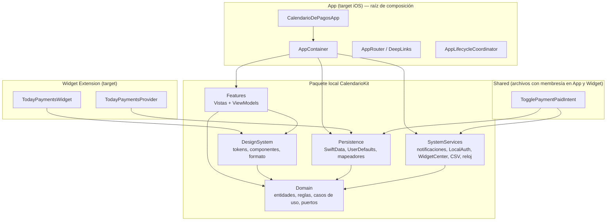
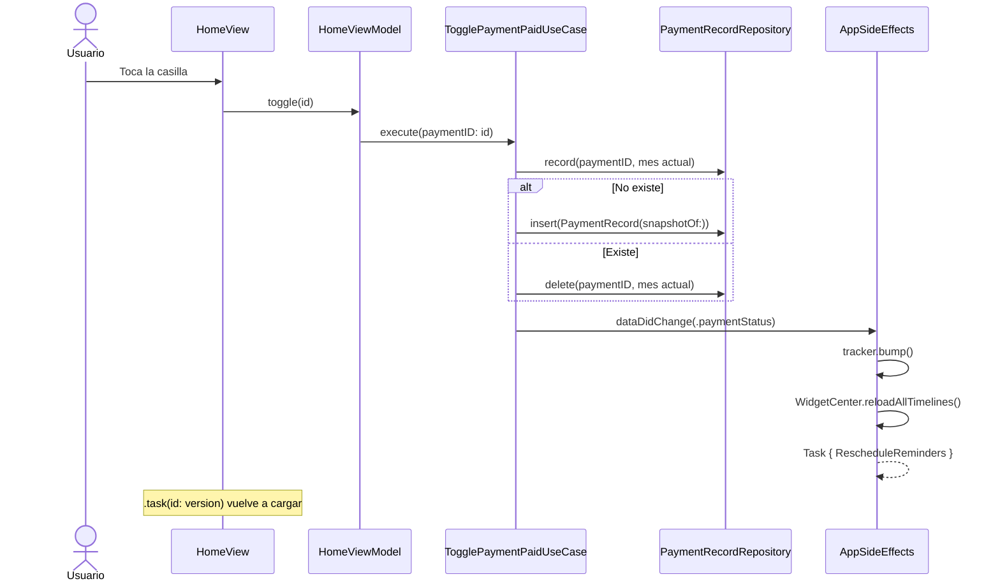
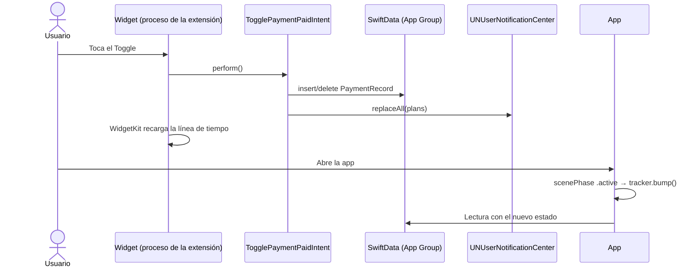

# Calendario de Pagos (iOS) — Arquitectura técnica y estándares de desarrollo

| Campo | Valor |
| --- | --- |
| Documento fuente | [Especificacion-funcional.md](Especificacion-funcional.md) |
| Versión | 1.1 (alineada con [investigacion.md](investigacion.md) y las App Review Guidelines del 16 de octubre de 2026) |
| Fecha | 2026-11-01 |
| Entorno de referencia | Xcode 26.5 · Swift 6.3 · SDK iOS 26 |
| Estado | En implementación: iteraciones 0 a 6 completadas ([§19](#19-plan-de-implementación)) |

Este documento traduce la especificación funcional a una arquitectura limpia, ejecutable y verificable. Define las capas, los módulos, el modelo de datos, los contratos entre componentes, los algoritmos de cada regla y los estándares con los que se escribe, prueba y entrega el código. Cada regla funcional (por ejemplo **PAG-07**) aparece en la [matriz de trazabilidad](#13-matriz-de-trazabilidad) con el componente que la resuelve y la prueba que la verifica.

## Índice

1. [Decisiones de arquitectura](#1-decisiones-de-arquitectura)
2. [Stack tecnológico](#2-stack-tecnológico)
3. [Vista de capas y regla de dependencia](#3-vista-de-capas-y-regla-de-dependencia)
4. [Estructura de módulos y carpetas](#4-estructura-de-módulos-y-carpetas)
5. [Capa de dominio](#5-capa-de-dominio)
6. [Casos de uso](#6-casos-de-uso)
7. [Capa de datos (persistencia)](#7-capa-de-datos-persistencia)
8. [Servicios de sistema](#8-servicios-de-sistema)
9. [Capa de presentación](#9-capa-de-presentación)
10. [Extensión de widgets](#10-extensión-de-widgets)
11. [Arquitectura aplicativa por funcionalidad](#11-arquitectura-aplicativa-por-funcionalidad)
12. [Flujos clave](#12-flujos-clave)
13. [Matriz de trazabilidad](#13-matriz-de-trazabilidad)
14. [Estándares de desarrollo](#14-estándares-de-desarrollo)
15. [Estrategia de pruebas](#15-estrategia-de-pruebas)
16. [Configuración del proyecto Xcode](#16-configuración-del-proyecto-xcode)
17. [Cumplimiento del App Store](#17-cumplimiento-del-app-store)
18. [Supuestos técnicos y riesgos](#18-supuestos-técnicos-y-riesgos)
19. [Plan de implementación](#19-plan-de-implementación)
20. [Referencias](#20-referencias)

---

## 1. Decisiones de arquitectura

Resumen de las decisiones estructurales (formato ADR abreviado). Cualquier cambio a una de ellas se documenta como un ADR nuevo en `docs/adr/`.

| # | Decisión | Motivo | Alternativa descartada |
| --- | --- | --- | --- |
| ADR-01 | **Clean Architecture** en 4 capas: Dominio, Datos, Servicios de sistema y Presentación, con una raíz de composición en la app | Las reglas (quincenas, día efectivo, 50/30/20, avisos) son lógica pura que debe probarse sin UI ni base de datos | MVC/MV con `@Query` en las vistas: mezcla reglas con UI y no se puede compartir con el widget |
| ADR-02 | **Paquete Swift local `CalendarioKit`** con un *target* por capa | El compilador impone la regla de dependencia; el widget reutiliza Dominio y Datos sin copiar código | Carpetas dentro del target de la app (la regla solo se cumpliría por disciplina) |
| ADR-03 | **SwiftData** con `VersionedSchema` desde la versión 1, en un **App Group** | Persistencia nativa, sin dependencias, compartida con la extensión de widgets | Core Data (más código), SQLite/GRDB (dependencia externa) |
| ADR-04 | **Dinero en unidades menores (`Int64` centavos)** dentro del tipo `Money` | Sumas exactas, sin errores de coma flotante, ordenables y fáciles de guardar | `Double` (inexacto), `Decimal` persistido (peor soporte en predicados) |
| ADR-05 | **Estado mensual derivado**: un pago está pendiente en un mes si no existe un `PaymentRecord` para ese pago y ese mes | MAR-03 se cumple sin procesos de "cierre de mes" que dependan de que la app se abra | Reiniciar banderas `isPaid` al cambiar de mes |
| ADR-06 | **Instantánea al pagar** (`PaymentRecord` guarda nombre, monto y categoría) | MAR-04 y MAR-05: el historial no cambia si se edita el pago | Relación viva con el pago |
| ADR-07 | **Borrado lógico** de pagos (`deletedAt`) | El Historial necesita saber qué pagos existían en meses pasados (HIS-01, HIS-03, HIS-04) | Borrado físico (se pierden los pendientes de meses anteriores) |
| ADR-08 | **MVVM con `@Observable`** (framework Observation) en Presentación | Estándar actual de SwiftUI; los ViewModels se prueban sin UI | `ObservableObject`/Combine (API anterior), TCA (dependencia y curva de aprendizaje) |
| ADR-09 | **Avisos con ventana deslizante** de 60 días de notificaciones locales de fecha concreta, reconciliada tras cada cambio | Cumple NOT-03, NOT-07 y NOT-08 (contenido distinto cada día) y respeta el límite de 64 avisos pendientes de iOS | Avisos repetitivos por día del mes (no resuelven PAG-07 ni NOT-08) |
| ADR-10 | **Cero dependencias de terceros** | Privacidad (NEG-03), sin SDKs de analítica, menos superficie de mantenimiento | — |
| ADR-11 | **Swift 6 (modo de lenguaje) con aislamiento por defecto en `MainActor`** en los módulos de UI | Seguridad ante carreras de datos verificada por el compilador; configuración por defecto de Xcode 26 | Swift 5 con verificación mínima |
| ADR-12 | **Ningún dato externo puede cerrar la app**: almacén, ajustes, enlaces profundos, parámetros de intenciones y entradas del usuario se validan; prohibidos `!`, `try!`, `as!` y `fatalError` en producción | Los cierres son la primera causa de rechazo (directriz 2.1(a)) y el fallo más común del código generado con IA | Confiar en que los datos guardados siempre son válidos |
| ADR-13 | **El binario de Release no contiene código de prueba**: fábricas de vista previa, datos semilla y argumentos de lanzamiento de prueba viven en `#if DEBUG` | Directrices 2.1(a) (sin contenido temporal) y 2.5.19 (sin funciones ocultas) | Valores por defecto de vista previa en `@Environment` |

## 2. Stack tecnológico

Versiones verificadas en el equipo de desarrollo (`xcodebuild -version`, `swift --version`) y documentación consultada vía Context7 (Apple Developer Documentation, Swift Migration Guide, Swift Testing).

| Área | Tecnología | Uso en la app |
| --- | --- | --- |
| Lenguaje | Swift 6.3, modo de lenguaje Swift 6 | Todo el código |
| IDE / SDK | Xcode 26.5, SDK iOS 26 | Compilación y firma. Obligatorio para subir a App Store Connect desde el 28 de abril de 2026 |
| Plataforma mínima | **iOS 26.0**, solo iPhone | Ver [§16](#16-configuración-del-proyecto-xcode) |
| UI | SwiftUI (`TabView` con `Tab`, `NavigationStack`, `searchable`, `ShareLink`) | Todas las pantallas |
| Estado de UI | Observation (`@Observable`, `@State`, `@Bindable`, `@Environment`) | ViewModels |
| Persistencia | SwiftData (`@Model`, `#Unique`, `#Index`, `VersionedSchema`, `SchemaMigrationPlan`) | Pagos y registros de pago |
| Preferencias | `UserDefaults(suiteName:)` del App Group, codificado como JSON | Salario, moneda, avisos, bloqueo |
| Gráficas | Swift Charts (`SectorMark`, `BarMark`) | Dashboard (DAS) e Historial (HIS-02) |
| Widgets | WidgetKit + App Intents (`Toggle(isOn:intent:)`) | Widget "Pagos de hoy" (WID) |
| Notificaciones | UserNotifications (`UNCalendarNotificationTrigger`) | Recordatorios (NOT) |
| Tareas en segundo plano | BackgroundTasks vía `.backgroundTask(.appRefresh)` | Extender la ventana de avisos |
| Autenticación local | LocalAuthentication (`LAPolicy.deviceOwnerAuthentication`) | Bloqueo de la app (SEG) |
| Exportación | CoreTransferable (`FileRepresentation`) + `ShareLink` | CSV (HER-08, HER-09) |
| Registro | `os.Logger` con niveles de privacidad | Diagnóstico sin exponer datos financieros |
| Pruebas | Swift Testing (unitarias e integración) · XCTest/XCUITest (UI) | [§15](#15-estrategia-de-pruebas) |
| Formato | `swift format` (incluido en la toolchain) | [§14.1](#141-código-y-formato) |

## 3. Vista de capas y regla de dependencia



**Regla de dependencia (obligatoria):** las flechas apuntan siempre hacia `Domain`. `Domain` no importa SwiftUI, SwiftData, UIKit, WidgetKit ni UserNotifications; solo `Foundation`. Las capas externas implementan los **puertos** (protocolos) que define el dominio.

| Módulo | Puede importar | Prohibido importar |
| --- | --- | --- |
| `Domain` | Foundation | Cualquier otro módulo del paquete, SwiftUI, SwiftData, UIKit |
| `Persistence` | Domain, SwiftData, Foundation | Features, DesignSystem, SystemServices, SwiftUI |
| `SystemServices` | Domain, UserNotifications, LocalAuthentication, WidgetKit, BackgroundTasks, UIKit (solo `UIApplication` URLs) | Features, Persistence, SwiftData |
| `DesignSystem` | Domain, SwiftUI, Charts | Persistence, SystemServices, SwiftData |
| `Features` | Domain, DesignSystem, SwiftUI, Charts | Persistence, SystemServices, SwiftData (las implementaciones llegan inyectadas) |
| App (target) | Todos | — |
| Widget (target) | Domain, Persistence, SystemServices (reloj y avisos de la intención), WidgetKit, AppIntents | Features, DesignSystem (usa su propia `WidgetPalette`) |

## 4. Estructura de módulos y carpetas

### 4.1 Árbol del repositorio

```text
calendariodepagos/
├── Especificacion-funcional.md
├── Arquitectura-tecnica.md
├── docs/adr/                              # Decisiones de arquitectura nuevas
├── .swift-format                          # Configuración de formato
├── calendariodepagos.xcodeproj
├── calendariodepagos/                     # Target App (delgado)
│   ├── CalendarioDePagosApp.swift         # @main, escenas, .backgroundTask
│   ├── Composition/AppContainer.swift     # Construye y conecta dependencias
│   ├── Composition/AppSideEffects.swift   # Implementa DataChangeObserving
│   ├── Navigation/AppRouter.swift         # Pestañas, rutas, hojas
│   ├── Lifecycle/AppLifecycleCoordinator.swift
│   ├── Lifecycle/NotificationDelegate.swift
│   ├── Resources/Assets.xcassets
│   ├── Resources/Localizable.xcstrings
│   ├── Resources/PrivacyInfo.xcprivacy
│   └── calendariodepagos.entitlements     # App Group
├── Shared/                                # Membresía: App + Widget
│   ├── DeepLink.swift                     # calendariodepagos://…
│   └── TogglePaymentPaidIntent.swift
├── TodayPaymentsWidget/                   # Target Widget Extension
│   ├── TodayPaymentsWidgetBundle.swift
│   ├── TodayPaymentsWidget.swift          # Configuración y vista por familia
│   ├── TodayPaymentsProvider.swift
│   ├── TodayEntry.swift
│   ├── WidgetPalette.swift
│   ├── Views/SummaryViews.swift           # Línea, rectángulo, pequeño y "sin acceso"
│   ├── Views/ListView.swift               # Mediano y grande, con PaidToggleStyle
│   ├── Resources/PrivacyInfo.xcprivacy
│   └── TodayPaymentsWidget.entitlements   # Mismo App Group
├── Packages/CalendarioKit/
│   ├── Package.swift
│   ├── Sources/
│   │   ├── Domain/
│   │   │   ├── Entities/          Payment, PaymentRecord, AppSettings
│   │   │   ├── ValueObjects/      Money, Currency, YearMonth, Fortnight, PaymentCategory, LockGracePeriod
│   │   │   ├── Rules/             MonthStatementBuilder, DashboardCalculator, AffordabilityCalculator,
│   │   │   │                      LeakDetector, BudgetPlanCalculator, ReminderPlanner, PaymentValidator, TextSearch
│   │   │   ├── UseCases/          Un archivo por caso de uso (§6)
│   │   │   ├── Ports/             Repositorios y servicios (protocolos)
│   │   │   ├── Errors/            DomainError, PaymentValidationError
│   │   │   └── Resources/Localizable.xcstrings   # Nombres de categorías (CAT-03)
│   │   ├── Persistence/
│   │   │   ├── Schema/            SchemaV1, MigrationPlan
│   │   │   ├── Repositories/      SwiftDataPaymentRepository, SwiftDataPaymentRecordRepository,
│   │   │   │                      UserDefaultsSettingsRepository
│   │   │   ├── Mappers/           Entity ↔ Domain
│   │   │   └── PersistenceStack.swift
│   │   ├── SystemServices/
│   │   │   ├── Notifications/     UserNotificationReminderScheduler
│   │   │   ├── Security/          LocalAuthenticationService
│   │   │   ├── Widgets/           WidgetCenterRefresher
│   │   │   ├── Export/            CSVPaymentExporter, PaymentsCSVFile (Transferable)
│   │   │   └── Time/              SystemClock
│   │   ├── DesignSystem/
│   │   │   ├── Tokens/            Colores semánticos, espaciado, tipografía
│   │   │   ├── Formatting/        MoneyFormatter, DateFormatting
│   │   │   └── Components/        MoneyText, PaidCheckbox, CategoryBadge, ProgressBar, EmptyStateView,
│   │   │                          SalaryRequiredCard, TrafficLightView
│   │   └── Features/
│   │       ├── Home/  Calendar/  Dashboard/  Fortnight/  History/  Tools/
│   │       ├── PaymentForm/  Settings/  Onboarding/  AppLock/  About/
│   │       └── Common/            LoadState, DataChangeTracker
│   └── Tests/
│       ├── DomainTests/  PersistenceTests/  SystemServicesTests/  FeaturesTests/
├── calendariodepagosTests/                # Pruebas de integración de la app (opcional)
└── calendariodepagosUITests/              # XCUITest
```

### 4.2 `Package.swift`

```swift
// swift-tools-version: 6.2
import PackageDescription

let mainActorByDefault: [SwiftSetting] = [
    .defaultIsolation(MainActor.self),
    .enableUpcomingFeature("NonisolatedNonsendingByDefault"),
    .enableUpcomingFeature("InferIsolatedConformances"),
]

let package = Package(
    name: "CalendarioKit",
    defaultLocalization: "es",
    platforms: [.iOS(.v26)],
    products: [
        .library(name: "Domain", targets: ["Domain"]),
        .library(name: "Persistence", targets: ["Persistence"]),
        .library(name: "SystemServices", targets: ["SystemServices"]),
        .library(name: "DesignSystem", targets: ["DesignSystem"]),
        .library(name: "Features", targets: ["Features"]),
    ],
    targets: [
        .target(name: "Domain", resources: [.process("Resources")]),
        .target(name: "Persistence", dependencies: ["Domain"]),
        .target(name: "SystemServices", dependencies: ["Domain"]),
        .target(name: "DesignSystem", dependencies: ["Domain"], swiftSettings: mainActorByDefault),
        .target(name: "Features", dependencies: ["Domain", "DesignSystem"], swiftSettings: mainActorByDefault),

        .testTarget(name: "DomainTests", dependencies: ["Domain"]),
        .testTarget(name: "PersistenceTests", dependencies: ["Persistence", "Domain"]),
        .testTarget(name: "SystemServicesTests", dependencies: ["SystemServices", "Domain"]),
        .testTarget(name: "FeaturesTests", dependencies: ["Features", "Domain"], swiftSettings: mainActorByDefault),
    ]
)
```

Notas:

- `Domain` no usa aislamiento por defecto en `MainActor`: sus tipos son valores `Sendable` utilizables desde la app, el widget y las pruebas sin saltos de actor.
- `Persistence` tampoco: sus repositorios son clases no `Sendable` que viven en el dominio de aislamiento donde se crean (el `MainActor` en la app, la función `perform`/`timeline` en el widget). Así el mismo código sirve en ambos procesos.
- `swift-tools-version: 6.2` activa el modo de lenguaje Swift 6 y `defaultIsolation` (SE-0466).

## 5. Capa de dominio

### 5.1 Glosario (lenguaje ubicuo)

El código se escribe en inglés (convención de la industria y de las API de Apple); la UI y los documentos, en español. Esta tabla es la referencia única de nombres.

| Término funcional | Tipo en código |
| --- | --- |
| Pago | `Payment` |
| Registro de pago (instantánea al marcar) | `PaymentRecord` |
| Mes / periodo | `YearMonth` |
| Quincena (Primera / Segunda) | `Fortnight` (`.first` / `.second`) |
| Categoría | `PaymentCategory` |
| Monto | `Money` |
| Moneda | `Currency` |
| Salario neto mensual | `AppSettings.monthlySalary` |
| Estado del mes (pagados y pendientes) | `MonthStatement` |
| Día efectivo (PAG-07) | `YearMonth.effectiveDay(for:)` |
| Aviso / recordatorio | `Reminder`, `ReminderPlan` |
| Bloqueo de la app | `AppLock` |
| ¿Puedo costearlo? | `AffordabilityCalculator` |
| Detector de fugas | `LeakDetector` |
| Plan 50/30/20 | `BudgetPlanCalculator` |
| Semáforo | `TrafficLight` |

### 5.2 Objetos de valor

```swift
/// Cantidad monetaria en unidades menores (centavos). La moneda es global (MND-02) y no forma parte del valor.
public struct Money: Hashable, Comparable, Sendable {
    public let minorUnits: Int64

    public static let zero = Money(minorUnits: 0)

    /// Límite absoluto aceptado en cualquier entrada (salario o pago): 9,999,999.99.
    /// Con este límite, ninguna suma, × 12 o porcentaje del dominio puede desbordar `Int64`.
    public static let maxInputMinorUnits: Int64 = 999_999_999

    public init(minorUnits: Int64) { self.minorUnits = minorUnits }

    /// Convierte la entrada del usuario redondeando a 2 decimales.
    /// Devuelve `nil` si el valor es negativo, no es finito o supera `maxInputMinorUnits`;
    /// así nunca se convierte un `Decimal` fuera de rango a `Int64`.
    public init?(validatingInput decimal: Decimal) {
        guard decimal.isFinite, decimal >= 0 else { return nil }
        var scaled = decimal * 100
        var rounded = Decimal()
        NSDecimalRound(&rounded, &scaled, 0, .plain)
        guard rounded <= Decimal(Self.maxInputMinorUnits) else { return nil }
        self.minorUnits = NSDecimalNumber(decimal: rounded).int64Value
    }

    public var decimal: Decimal { Decimal(minorUnits) / 100 }
    public var isNegative: Bool { minorUnits < 0 }

    public static func + (lhs: Money, rhs: Money) -> Money { Money(minorUnits: lhs.minorUnits + rhs.minorUnits) }
    public static func - (lhs: Money, rhs: Money) -> Money { Money(minorUnits: lhs.minorUnits - rhs.minorUnits) }
    public static func < (lhs: Money, rhs: Money) -> Bool { lhs.minorUnits < rhs.minorUnits }

    public func multiplied(by factor: Int64) -> Money { Money(minorUnits: minorUnits * factor) }
    /// Porcentaje entero (p. ej. 50 → 50 %). Trunca hacia cero.
    public func percent(_ value: Int64) -> Money { Money(minorUnits: minorUnits * value / 100) }
    /// Proporción respecto de otro monto; 0 si el divisor es 0.
    public func ratio(to other: Money) -> Double {
        other.minorUnits == 0 ? 0 : Double(minorUnits) / Double(other.minorUnits)
    }
}

public extension Sequence where Element == Money {
    func sum() -> Money { reduce(.zero, +) }
}

public enum Currency: String, CaseIterable, Codable, Sendable {
    case usd = "USD"
    case eur = "EUR"
}
```

```swift
/// Mes del calendario gregoriano (la app siempre usa `Calendar(identifier: .gregorian)`, §8.5).
/// Clave de persistencia AAAAMM (p. ej. 202610). Solo se construye con valores válidos.
public struct YearMonth: Hashable, Comparable, Sendable {
    public let year: Int
    public let month: Int  // 1...12

    /// `nil` si el mes o el año están fuera de rango (datos corruptos o entrada inválida).
    public init?(year: Int, month: Int) {
        guard (1...12).contains(month), (1970...9999).contains(year) else { return nil }
        self.year = year
        self.month = month
    }

    /// `Calendar.component(_:from:)` no devuelve opcionales: no hay desempaquetado forzado.
    public init(containing date: Date, calendar: Calendar) {
        self.year = calendar.component(.year, from: date)
        self.month = calendar.component(.month, from: date)
    }

    public init?(key: Int) { self.init(year: key / 100, month: key % 100) }

    public var key: Int { year * 100 + month }

    public static func < (lhs: YearMonth, rhs: YearMonth) -> Bool { lhs.key < rhs.key }

    /// Aritmética entera; los años de la app son positivos, así que la división trunca correctamente.
    public func adding(months: Int) -> YearMonth {
        let index = year * 12 + (month - 1) + months
        return YearMonth(uncheckedYear: index / 12, month: index % 12 + 1)
    }

    /// Cálculo gregoriano puro: no depende de API opcionales de `Calendar`.
    public var numberOfDays: Int {
        switch month {
        case 2: Self.isLeap(year) ? 29 : 28
        case 4, 6, 9, 11: 30
        default: 31
        }
    }

    /// PAG-07: un pago programado en un día que el mes no tiene se muestra el último día del mes.
    public func effectiveDay(for scheduledDay: Int) -> Int {
        min(max(scheduledDay, 1), numberOfDays)
    }

    /// Fecha del día efectivo. Opcional porque `Calendar.date(from:)` lo es; quien llama decide qué hacer con `nil`.
    public func date(day: Int, calendar: Calendar) -> Date? {
        calendar.date(from: DateComponents(year: year, month: month, day: effectiveDay(for: day)))
    }

    private init(uncheckedYear: Int, month: Int) {
        self.year = uncheckedYear
        self.month = month
    }

    private static func isLeap(_ year: Int) -> Bool {
        (year % 4 == 0 && year % 100 != 0) || year % 400 == 0
    }
}
```

`YearMonth` no conforma a `Codable` a propósito: la decodificación sintetizada se saltaría la validación. En SwiftData se guarda solo la clave `Int` y se reconstruye con `YearMonth(key:)`, que descarta claves inválidas.

```swift
/// PAG-03: la quincena se deriva del día; el usuario no la elige.
public enum Fortnight: Int, CaseIterable, Sendable, Codable {
    case first = 1   // días 1–15
    case second = 2  // días 16–31

    public init(dayOfMonth: Int) { self = dayOfMonth <= 15 ? .first : .second }
}

/// CAT-01: lista fija. Los valores crudos son estables y se persisten; nunca se renombran.
public enum PaymentCategory: String, CaseIterable, Codable, Sendable {
    case expenses = "gastos"
    case savings = "ahorros"
    case investments = "inversiones"
    case wellbeing = "bienestar"
    case loans = "prestamos"
    case transport = "transportes"
    case utilities = "servicios"

    /// PAG-02 / CAT-02
    public static let `default`: PaymentCategory = .expenses

    /// Valor robusto ante datos desconocidos.
    public init(storedValue: String) { self = PaymentCategory(rawValue: storedValue) ?? .default }

    /// CAT-03: nombre único para todas las pantallas, el widget y el CSV.
    public var localizedName: LocalizedStringResource {
        switch self {
        case .expenses: "Gastos"
        case .savings: "Ahorros"
        case .investments: "Inversiones"
        case .wellbeing: "Bienestar"
        case .loans: "Préstamos"
        case .transport: "Transportes"
        case .utilities: "Servicios"
        }
    }

    /// Clasificación para la regla 50/30/20 (ver supuesto S-03).
    public var budgetBucket: BudgetBucket {
        switch self {
        case .utilities, .transport, .loans, .expenses: .needs
        case .wellbeing: .wants
        case .savings, .investments: .savings
        }
    }
}

public enum BudgetBucket: Sendable { case needs, wants, savings }
```

### 5.3 Entidades

```swift
public struct Payment: Identifiable, Hashable, Sendable {
    public let id: UUID
    public var name: String
    public var amount: Money
    public var dayOfMonth: Int            // 1...31 (PAG-01)
    public var category: PaymentCategory  // PAG-02
    public let createdAt: Date
    public var updatedAt: Date
    public var deletedAt: Date?           // ADR-07

    public var fortnight: Fortnight { Fortnight(dayOfMonth: dayOfMonth) }

    /// Un pago existe en un mes si se creó ese mes o antes y no se eliminó ese mes ni antes.
    public func isActive(in period: YearMonth, calendar: Calendar) -> Bool {
        guard YearMonth(containing: createdAt, calendar: calendar) <= period else { return false }
        guard let deletedAt else { return true }
        return YearMonth(containing: deletedAt, calendar: calendar) > period
    }
}

/// MAR-04: instantánea inmutable del pago en el momento de marcarlo.
public struct PaymentRecord: Identifiable, Hashable, Sendable {
    public let id: UUID
    public let paymentID: UUID
    public let period: YearMonth
    public let name: String
    public let amount: Money
    public let category: PaymentCategory
    public let markedAt: Date

    public init(snapshotOf payment: Payment, period: YearMonth, markedAt: Date) {
        self.id = UUID()
        self.paymentID = payment.id
        self.period = period
        self.name = payment.name
        self.amount = payment.amount
        self.category = payment.category
        self.markedAt = markedAt
    }
}

public struct AppSettings: Equatable, Sendable, Codable {
    public var currency: Currency?           // nil hasta completar MND-01
    public var monthlySalary: Money?         // nil = sin salario (DAS-04, QUI-04)
    public var reminders = ReminderSettings()
    public var appLock = AppLockSettings()
    public var hasCompletedOnboarding = false
}

public struct ReminderSettings: Equatable, Sendable, Codable {
    public var isEnabled = true   // NOT-01
    public var hour = 8           // NOT-01
    public var minute = 0
}

public struct AppLockSettings: Equatable, Sendable, Codable {
    public var isEnabled = false                    // SEG-01
    public var gracePeriod: LockGracePeriod = .oneMinute  // SEG-02
}

public enum LockGracePeriod: Int, CaseIterable, Sendable, Codable {
    case immediately = 0, oneMinute = 60, fiveMinutes = 300, fifteenMinutes = 900
}
```

### 5.4 Invariantes y validación

| Regla | Validación (en `PaymentValidator` / `SalaryValidator`) | Error |
| --- | --- | --- |
| PAG-01 | `name.trimmingCharacters(in: .whitespacesAndNewlines)` no vacío, máx. 60 caracteres (S-01) | `.nameRequired`, `.nameTooLong` |
| PAG-01 | `amount > 0` y `amount ≤ 9,999,999.99` (S-01) | `.amountRequired`, `.amountOutOfRange` |
| PAG-01 | `1 ≤ dayOfMonth ≤ 31` | `.dayOutOfRange` |
| PAG-02 | Categoría ausente → `.default` | — |
| CFG-01 / DAS-05 | `0 < salary ≤ 9,999,999.00`; vacío = sin salario | `SalaryValidationError.outOfRange` |

El validador devuelve **todos** los errores a la vez (`[PaymentValidationError]`) para que el formulario los muestre junto a cada campo. Los casos de uso vuelven a validar antes de persistir (defensa en profundidad).

### 5.5 Reglas de negocio puras

Todas son funciones o tipos sin estado, sin dependencias de plataforma, con `Calendar` y fecha actual inyectados.

#### `MonthStatementBuilder` — estado de un mes (MAR, HIS, CAL, QUI)

```swift
public struct MonthStatement: Sendable {
    public let period: YearMonth
    public let items: [Item]            // ordenados por día efectivo y nombre
    public var paid: [Item] { items.filter(\.isPaid) }
    public var pending: [Item] { items.filter { !$0.isPaid } }
    public var paidTotal: Money { paid.map(\.displayAmount).sum() }
    public var compliance: Double { items.isEmpty ? 0 : Double(paid.count) / Double(items.count) }  // HIS-01

    public struct Item: Identifiable, Sendable {
        public let id: UUID                 // paymentID
        public let name: String
        public let category: PaymentCategory
        public let effectiveDay: Int
        public let currentAmount: Money?    // nil si el pago ya no existe
        public let record: PaymentRecord?   // nil = pendiente
        public var isPaid: Bool { record != nil }
        /// Pagado: monto registrado. Pendiente: monto actual.
        public var displayAmount: Money { record?.amount ?? currentAmount ?? .zero }
        /// MAR-05: "pagado por $X" cuando el monto cambió tras marcarlo.
        public var paidAmountDiffers: Bool {
            guard let record, let currentAmount else { return false }
            return record.amount != currentAmount
        }
    }
}
```

Algoritmo `build(period:payments:records:calendar:)`:

1. `active = payments.filter { $0.isActive(in: period, calendar:) }`.
2. Para cada pago activo: `Item` con su `record` del mes si existe (pagado) o `nil` (pendiente). Nombre y categoría: los del registro si está pagado (MAR-04), los actuales si está pendiente.
3. Para cada registro del mes cuyo pago no esté activo (eliminado después de pagarlo): `Item` construido solo con la instantánea.
4. `effectiveDay = period.effectiveDay(for: dayOfMonth)` (PAG-07). Orden: día efectivo ascendente, luego nombre con `localizedStandardCompare`.

Las quincenas y los días se obtienen filtrando `items` (`Fortnight(dayOfMonth:)` usa el día programado; `effectiveDay` se usa para ubicar el pago en una fecha).

#### `DashboardCalculator` (DAS)

| Salida | Fórmula |
| --- | --- |
| `totalMonthly` | Suma de `amount` de pagos activos en el mes actual |
| `available` | `salary − totalMonthly` (puede ser negativo, DAS-02) |
| `spentRatio` | `totalMonthly.ratio(to: salary)` |
| `level` | `.healthy` si `spentRatio ≤ 0.5`, `.warning` si `> 0.5` (DAS-01) |
| `isOverdrawn` | `available < 0` (DAS-02) |
| `categoryShares` | Por categoría con total > 0: `total`, `share = total.ratio(to: totalMonthly)` (DAS-03) |
| `emergencyFund` | `totalMonthly × 3`, `× 6`, `× 12` |

Si `salary == nil`, `availability` es `nil` y la UI muestra la invitación (DAS-04). Las tarjetas de categorías y fondo de emergencia no dependen del salario y se muestran siempre que haya pagos.

#### `AffordabilityCalculator` (HER-01 a HER-03)

```text
entradas: salary, newExpense, kind ∈ {need, want}, pagos activos
needs   = Σ pagos con bucket .needs   + (kind == .need ? newExpense : 0)
wants   = Σ pagos con bucket .wants   + (kind == .want ? newExpense : 0)
savings = salary − needs − wants            // lo que queda para ahorro (incluye pagos de Ahorros/Inversiones)
ratio   = savings / salary
semáforo:
  rojo     si newExpense > salary  ó  ratio < 0.10
  amarillo si 0.10 ≤ ratio < 0.15
  verde    si ratio ≥ 0.15
```

La salida incluye `needs`, `wants`, `savings`, sus porcentajes y el semáforo, para mostrar la distribución recalculada frente a la ideal 50/30/20. El semáforo se expone también como función pura `static func light(savings: Money, salary: Money, newExpense: Money) -> TrafficLight` para probar los umbrales de forma aislada.

#### `LeakDetector` (HER-04 a HER-06)

`items = pagos activos ordenados por amount desc, luego nombre; annualCost = amount × 12; total = Σ annualCost`.

#### `BudgetPlanCalculator` (HER-07)

`needs = salary.percent(50)`, `wants = salary.percent(30)`, `savings = salary − needs − wants` (el resto absorbe el redondeo).

#### `TextSearch` (PAG-05)

```swift
public enum TextSearch {
    public static func normalize(_ text: String) -> String {
        text.folding(options: [.caseInsensitive, .diacriticInsensitive, .widthInsensitive], locale: .current)
            .trimmingCharacters(in: .whitespacesAndNewlines)
    }
    public static func matches(_ name: String, query: String) -> Bool {
        let q = normalize(query)
        return q.isEmpty || normalize(name).contains(q)
    }
}
```

#### `ReminderPlanner` (NOT-01 a NOT-08)

```swift
public struct ReminderPlan: Equatable, Sendable {
    public let identifier: String          // "reminder.2026-10-30"
    public let fireDate: DateComponents    // año, mes, día, hora, minuto
    public let pendingNames: [String]
}

public enum ReminderPlanner {
    public static let horizonDays = 60     // < 64 avisos pendientes permitidos por iOS
    public static func plan(now: Date, settings: ReminderSettings, payments: [Payment],
                            currentMonthRecords: [PaymentRecord], calendar: Calendar) -> [ReminderPlan]
}
```

Algoritmo:

1. Si `settings.isEnabled == false` → `[]` (NOT-05).
2. Para `offset` en `0..<horizonDays`: `day = startOfDay(now) + offset días`; `fire = day` a `hour:minute`. Si `fire <= now`, se omite.
3. `period = YearMonth(containing: day)`; `due` = pagos activos en `period` cuyo `effectiveDay == día de day` (PAG-07).
4. Si `due` está vacío → se omite (NOT-03).
5. Si `period` es el mes actual, se quitan de `due` los que tienen registro en el mes. Si no queda ninguno → se omite (NOT-08).
6. Se emite un único plan para ese día (NOT-03: máximo uno por día) con los nombres pendientes, sin montos (NOT-07).

## 6. Casos de uso

Cada caso de uso es un `struct` con sus dependencias (puertos) inyectadas en el inicializador y un único método `execute`. Los casos de uso que modifican datos notifican el cambio a `DataChangeObserving` (ver [§9.4](#94-propagación-de-cambios)).

### 6.1 Puertos (protocolos del dominio)

```swift
public protocol PaymentRepository {
    func payments(includingDeleted: Bool) throws -> [Payment]
    func payment(id: UUID) throws -> Payment?
    func insert(_ payment: Payment) throws
    func update(_ payment: Payment) throws
    func markDeleted(id: UUID, at date: Date) throws
}

public protocol PaymentRecordRepository {
    func records(in period: YearMonth) throws -> [PaymentRecord]
    func records(from start: YearMonth, through end: YearMonth) throws -> [PaymentRecord]
    func record(paymentID: UUID, period: YearMonth) throws -> PaymentRecord?
    func insert(_ record: PaymentRecord) throws
    func delete(paymentID: UUID, period: YearMonth) throws
}

public protocol SettingsRepository {
    func load() -> AppSettings
    func save(_ settings: AppSettings) throws
}

public protocol DateProviding: Sendable {
    var now: Date { get }
    var calendar: Calendar { get }
}

public enum DataChange: Sendable { case payments, paymentStatus, salary, currency, reminderSettings }

public protocol DataChangeObserving {
    func dataDidChange(_ change: DataChange)
}

public enum ReminderAuthorization: Sendable { case notDetermined, authorized, denied }

public protocol ReminderScheduling: Sendable {
    func authorizationStatus() async -> ReminderAuthorization
    func requestAuthorization() async -> Bool
    func replaceAll(with plans: [ReminderPlan]) async throws
    func removeAll() async
}

public enum DeviceOwnerAuthAvailability: Sendable { case available, passcodeNotSet, unavailable }

public enum DeviceOwnerAuthResult: Sendable { case success, cancelled, failed, passcodeNotSet }

public protocol DeviceOwnerAuthenticating: Sendable {
    func availability() -> DeviceOwnerAuthAvailability
    func authenticate(reason: String) async -> DeviceOwnerAuthResult
}

public protocol WidgetRefreshing: Sendable {
    func reloadAll()
}

public protocol PaymentsExporting {
    /// Escribe el CSV y devuelve la URL temporal del archivo.
    func export(_ payments: [Payment], currency: Currency, date: Date) throws -> URL
}
```

### 6.2 Catálogo

| Caso de uso | Entrada | Salida | Reglas |
| --- | --- | --- | --- |
| `CompleteOnboardingUseCase` | `Currency` | — | MND-01 |
| `CreatePaymentUseCase` | `PaymentDraft` | `Payment` | PAG-01, PAG-02, PAG-03 |
| `UpdatePaymentUseCase` | `UUID`, `PaymentDraft` | `Payment` | PAG-01, MAR-04 (no toca registros) |
| `DeletePaymentUseCase` | `UUID` | — | PAG-04 (la confirmación es de UI), ADR-07 |
| `GetHomeSummaryUseCase` | — | `HomeSummary` (hoy, quincenas, lista, `isEmpty`) | PAG-06, PAG-07, PAG-08, MAR-01 |
| `SearchPaymentsUseCase` | `query` | `[MonthStatement.Item]` | PAG-05 |
| `TogglePaymentPaidUseCase` | `paymentID`, `period?` | `Bool` (nuevo estado) | MAR-01 a MAR-04, HIS-04, WID-07 |
| `GetFortnightDetailUseCase` | `Fortnight` | `FortnightDetail` (items, total, `remaining?`) | QUI-01 a QUI-04 |
| `GetCalendarMonthUseCase` | `YearMonth` | `CalendarMonth` (días con pagos) | CAL-01, CAL-02, PAG-07 |
| `GetDayDetailUseCase` | `Date` | `DayDetail` (total, items, progreso, `isEditable`) | CAL-03 a CAL-05 |
| `GetHistoryOverviewUseCase` | — | `HistoryOverview` (meses, gráfica 6 meses) | HIS-01, HIS-02 |
| `GetMonthStatementUseCase` | `YearMonth` | `MonthStatement` | HIS-03, HIS-04 |
| `GetDashboardUseCase` | — | `DashboardSummary` | DAS-01 a DAS-04 |
| `EvaluateAffordabilityUseCase` | `Money`, `ExpenseKind` | `AffordabilityResult?` | HER-01 a HER-03 |
| `GetLeakReportUseCase` | — | `LeakReport` | HER-04 a HER-06 |
| `GetBudgetPlanUseCase` | — | `BudgetPlan?` | HER-07 |
| `ExportPaymentsUseCase` | — | `URL` | HER-08, MND-04, CAT-03 |
| `UpdateSalaryUseCase` | `Money?` | — | CFG-01, DAS-05, WID-03 |
| `ChangeCurrencyUseCase` | `Currency` | — | MND-03 |
| `UpdateReminderSettingsUseCase` | `ReminderSettings` | — | NOT-02, NOT-05 |
| `RescheduleRemindersUseCase` | — | — | NOT-01 a NOT-08 |
| `RequestReminderPermissionUseCase` | — | `ReminderAuthorization` | NOT-06 |
| `UpdateAppLockSettingsUseCase` | `AppLockSettings` | — | SEG-01, SEG-02 |
| `GetTodayWidgetSnapshotUseCase` | `Date` | `TodaySnapshot` (sin montos) | WID-01, WID-04 |

Ejemplo de referencia:

```swift
public struct TogglePaymentPaidUseCase {
    private let payments: PaymentRepository
    private let records: PaymentRecordRepository
    private let clock: DateProviding
    private let observer: DataChangeObserving

    public init(payments: PaymentRepository, records: PaymentRecordRepository,
                clock: DateProviding, observer: DataChangeObserving) {
        self.payments = payments
        self.records = records
        self.clock = clock
        self.observer = observer
    }

    /// Marca o desmarca un pago en `period` (por defecto, el mes actual). Devuelve el nuevo estado.
    @discardableResult
    public func execute(paymentID: UUID, period: YearMonth? = nil) throws -> Bool {
        let current = YearMonth(containing: clock.now, calendar: clock.calendar)
        let period = period ?? current
        guard period <= current else { throw DomainError.futurePeriod }

        if try records.record(paymentID: paymentID, period: period) != nil {
            try records.delete(paymentID: paymentID, period: period)
            observer.dataDidChange(.paymentStatus)
            return false
        }

        guard let payment = try payments.payment(id: paymentID) else { throw DomainError.paymentNotFound }
        guard payment.isActive(in: period, calendar: clock.calendar) else { throw DomainError.paymentNotInPeriod }

        try records.insert(PaymentRecord(snapshotOf: payment, period: period, markedAt: clock.now))  // MAR-04
        observer.dataDidChange(.paymentStatus)
        return true
    }
}
```

## 7. Capa de datos (persistencia)

### 7.1 Esquema SwiftData versionado

```swift
import SwiftData

public enum SchemaV1: VersionedSchema {
    public static let versionIdentifier = Schema.Version(1, 0, 0)
    public static var models: [any PersistentModel.Type] { [PaymentEntity.self, PaymentRecordEntity.self] }

    @Model
    public final class PaymentEntity {
        #Unique<PaymentEntity>([\.id])
        #Index<PaymentEntity>([\.deletedAt], [\.dayOfMonth])

        public var id: UUID
        public var name: String
        public var amountMinorUnits: Int64
        public var dayOfMonth: Int
        public var categoryRaw: String      // enum como String: predicados fiables
        public var createdAt: Date
        public var updatedAt: Date
        public var deletedAt: Date?

        public init(id: UUID, name: String, amountMinorUnits: Int64, dayOfMonth: Int,
                    categoryRaw: String, createdAt: Date, updatedAt: Date, deletedAt: Date?) {
            self.id = id
            self.name = name
            self.amountMinorUnits = amountMinorUnits
            self.dayOfMonth = dayOfMonth
            self.categoryRaw = categoryRaw
            self.createdAt = createdAt
            self.updatedAt = updatedAt
            self.deletedAt = deletedAt
        }
    }

    @Model
    public final class PaymentRecordEntity {
        /// Un solo registro por pago y mes.
        #Unique<PaymentRecordEntity>([\.id], [\.paymentID, \.periodKey])
        #Index<PaymentRecordEntity>([\.periodKey], [\.paymentID])

        public var id: UUID
        public var paymentID: UUID          // referencia por valor, no relación (ADR-06)
        public var periodKey: Int           // AAAAMM
        public var name: String
        public var amountMinorUnits: Int64
        public var categoryRaw: String
        public var markedAt: Date

        public init(id: UUID, paymentID: UUID, periodKey: Int, name: String,
                    amountMinorUnits: Int64, categoryRaw: String, markedAt: Date) {
            self.id = id
            self.paymentID = paymentID
            self.periodKey = periodKey
            self.name = name
            self.amountMinorUnits = amountMinorUnits
            self.categoryRaw = categoryRaw
            self.markedAt = markedAt
        }
    }
}

public typealias PaymentEntity = SchemaV1.PaymentEntity
public typealias PaymentRecordEntity = SchemaV1.PaymentRecordEntity

public enum CalendarioMigrationPlan: SchemaMigrationPlan {
    public static var schemas: [any VersionedSchema.Type] { [SchemaV1.self] }
    public static var stages: [MigrationStage] { [] }
}
```

Reglas del esquema:

- Todo cambio de modelo crea `SchemaV2` y una etapa `.lightweight` o `.custom` en `CalendarioMigrationPlan`. Nunca se modifica un esquema publicado.
- `@Model` solo existe en `Persistence`. Las demás capas trabajan con `Payment` y `PaymentRecord` (structs), lo que evita objetos administrados obsoletos entre procesos (app ↔ widget) y cruces de actor.
- No hay relaciones SwiftData: la instantánea referencia el pago por `UUID`.

### 7.2 Contenedor compartido (App Group)

```swift
public enum PersistenceStack {
    public static let appGroupID = "group.com.davidddfm.calendariodepagos"

    public static func makeContainer(inMemory: Bool = false) throws -> ModelContainer {
        let schema = Schema(versionedSchema: SchemaV1.self)
        let configuration = ModelConfiguration(
            "CalendarioDePagos",
            schema: schema,
            isStoredInMemoryOnly: inMemory,
            groupContainer: inMemory ? .none : .identifier(appGroupID),
            cloudKitDatabase: .none   // 100 % local: nunca sincroniza aunque exista el entitlement
        )
        return try ModelContainer(for: schema, migrationPlan: CalendarioMigrationPlan.self,
                                  configurations: [configuration])
    }
}
```

- La app crea **un** `ModelContainer` al arrancar y usa `container.mainContext` (en `MainActor`). El volumen de datos es pequeño (decenas de pagos, un registro por pago y mes), por lo que no se necesita `@ModelActor`. Si una operación supera 16 ms en perfiles de Instruments, se mueve a un `@ModelActor` pasando solo `UUID`/`PersistentIdentifier` entre actores.
- El widget y el App Intent crean su propio `ModelContext(container)` por invocación.
- Si `makeContainer` falla en la app, se muestra una pantalla de error recuperable con opción de reintentar y se registra con `Logger.error`; no se usa `fatalError` en producción (la plantilla actual de Xcode sí lo usa y debe reemplazarse).
- Si falla en el widget, la línea de tiempo entrega una entrada vacía ("Abre la app para ver tus pagos") con política `.after(+15 min)`; si falla en la intención, `perform()` lanza el error y WidgetKit mantiene el estado anterior. Ninguna ruta cierra el proceso.

### 7.3 Protección de datos

El almacén vive en el App Group con la clase de protección por defecto de iOS (`completeUntilFirstUserAuthentication`): los datos están cifrados en reposo hasta el primer desbloqueo tras reiniciar. **No** se usa `NSFileProtectionComplete` porque el widget de pantalla bloqueada (WID, línea y rectángulo) debe leer nombres y estados con el teléfono bloqueado. Los montos nunca salen de la app hacia superficies visibles sin desbloqueo (WID-01, NOT-07).

### 7.4 Preferencias

`UserDefaultsSettingsRepository` guarda `AppSettings` como JSON bajo la clave versionada `settings.v1` en `UserDefaults(suiteName: appGroupID)`. Un único valor codificado evita estados parciales y facilita migrar (`settings.v2`). Los valores por defecto viven en `AppSettings` (dominio), no en el repositorio.

- `AppSettings` implementa `init(from:)` manual con `decodeIfPresent` y valores por defecto para cada campo: un campo nuevo o ilegible no invalida el resto.
- Tras decodificar se valida: salario fuera de `0 < x ≤ 9,999,999` → `nil`; hora fuera de 0–23 o minuto fuera de 0–59 → 8:00.
- Si el JSON completo es ilegible, se registra el error y se cargan los valores por defecto **conservando** `hasCompletedOnboarding = true` cuando ya existen pagos en el almacén, para no repetir el onboarding a un usuario con datos.
- Solo se usa `UserDefaults(suiteName:)`; no se usa `UserDefaults.standard` ni `@AppStorage`, para que el manifiesto de privacidad declare exactamente un motivo (ver [§17.4](#174-manifiesto-de-privacidad)).

### 7.5 Mapeo y validación de lo persistido

Cada repositorio convierte `Entity ↔ Domain` en `Mappers/`. **El almacén se trata como entrada no confiable** (puede venir de una versión anterior, de la otra extensión o estar dañado): el mapeador devuelve `nil` y registra el caso, en lugar de cerrar la app, cuando encuentra:

| Campo | Regla al leer | Acción si falla |
| --- | --- | --- |
| `dayOfMonth` | 1…31 | Se omite el pago y se registra |
| `amountMinorUnits` | 0 < x ≤ `Money.maxInputMinorUnits` | Se omite y se registra |
| `periodKey` | `YearMonth(key:) != nil` | Se omite el registro |
| `categoryRaw` | Valor conocido | `PaymentCategory(storedValue:)` → "Gastos" |
| `name` | No vacío tras recortar | Se muestra "Sin nombre" |

Los repositorios llaman a `context.save()` explícitamente tras cada escritura (no se depende del autosave) para que el widget vea los cambios de inmediato. Insertar un `PaymentRecordEntity` con un par `(paymentID, periodKey)` existente hace *upsert* por la restricción `#Unique`, lo que vuelve idempotente un doble toque en la casilla.

## 8. Servicios de sistema

### 8.1 Recordatorios — `UserNotificationReminderScheduler`

Implementa `ReminderScheduling` con `UNUserNotificationCenter` como un `actor`, de modo que dos reconciliaciones seguidas (por ejemplo, marcar dos pagos rápido) nunca se intercalan:

```swift
public actor UserNotificationReminderScheduler: ReminderScheduling {
    private static let prefix = "reminder."

    /// Reconciliación por diferencias. No usa `removeAllPendingNotificationRequests()`:
    /// esa llamada se ejecuta de forma asíncrona en otro hilo y podría borrar avisos recién añadidos.
    public func replaceAll(with plans: [ReminderPlan]) async throws {
        let center = UNUserNotificationCenter.current()
        let wanted = Set(plans.map(\.identifier))
        let obsolete = await center.pendingNotificationRequests()
            .map(\.identifier)
            .filter { $0.hasPrefix(Self.prefix) && !wanted.contains($0) }
        center.removePendingNotificationRequests(withIdentifiers: obsolete)

        for plan in plans {
            let content = UNMutableNotificationContent()
            content.title = String(localized: "Pagos de hoy")
            content.body = ReminderText.body(names: plan.pendingNames)   // Sin montos (NOT-07)
            content.sound = .default
            content.threadIdentifier = "daily-reminders"
            content.userInfo = ["route": DeepLink.today.rawValue]       // NOT-09; solo un identificador, nunca datos
            let trigger = UNCalendarNotificationTrigger(dateMatching: plan.fireDate, repeats: false)
            // Añadir con un identificador existente reemplaza el aviso pendiente: la operación es idempotente.
            try await center.add(UNNotificationRequest(identifier: plan.identifier, content: content, trigger: trigger))
        }
    }
}
```

- Los identificadores llevan el prefijo `reminder.` para que la reconciliación nunca toque avisos ajenos a esta función.
- Sin `UNNotificationCategory` ni acciones (NOT-09).
- El contenido no incluye montos, totales ni salario (NOT-07). La directriz 4.5.4 pide no enviar información personal sensible por *push*; estos avisos son locales y solo llevan nombres, como decidió producto. Si producto considera sensibles algunos nombres (p. ej. "Terapia"), la mitigación sería un ajuste "Ocultar nombres en avisos", que hoy está fuera de alcance.
- `ReminderText.body` lista hasta 4 nombres y agrega "y N más".
- Las notificaciones locales programadas persisten tras reiniciar el teléfono y actualizar la app (NOT-04). La ventana de 60 días se renueva:
  1. Tras cada cambio de datos o ajustes (`AppSideEffects`).
  2. Cada vez que la app pasa a `.active`.
  3. En `BGAppRefreshTask` (`.backgroundTask(.appRefresh("com.davidddfm.calendariodepagos.reminders"))`), reprogramado al pasar a segundo plano.
  4. Tras cambios de zona horaria o de reloj (`UIApplication.significantTimeChangeNotification`, `NSSystemTimeZoneDidChange`).
- `BGAppRefreshTask` solo reprograma avisos locales, uso permitido explícitamente por la directriz 2.5.4 ("local notifications"). No hace ninguna otra tarea en segundo plano.
- **Permiso (NOT-06):** se solicita **en contexto**, justo después de guardar el primer pago, con `requestAuthorization(options: [.alert, .sound])` (sin `.badge`, porque la app no usa globos). Antes se muestra una explicación breve con dos botones de igual peso, "Activar recordatorios" y "Ahora no"; ninguno simula el diálogo del sistema (directriz 5.1.1(iv)). Si el usuario elige "Ahora no", no se vuelve a preguntar; el interruptor de Ajustes ofrece activarlos después. Si el estado es `.denied`, Ajustes muestra "Notificaciones bloqueadas" y un botón que abre `UIApplication.openNotificationSettingsURLString`. El estado se relee en cada `.active`. La app funciona completa sin notificaciones (directriz 4.5.4).

### 8.2 Bloqueo — `LocalAuthenticationService` y `AppLockController`

`LocalAuthenticationService` implementa `DeviceOwnerAuthenticating`:

```swift
public func availability() -> DeviceOwnerAuthAvailability {
    var error: NSError?
    if LAContext().canEvaluatePolicy(.deviceOwnerAuthentication, error: &error) { return .available }
    return (error as? LAError)?.code == .passcodeNotSet ? .passcodeNotSet : .unavailable
}

/// Un `LAContext` nuevo por intento: un contexto reutilizado puede devolver una autenticación ya evaluada.
/// Los errores no se silencian con `try?`: se traducen para que la UI distinga cancelar de fallar.
public func authenticate(reason: String) async -> DeviceOwnerAuthResult {
    do {
        return try await LAContext().evaluatePolicy(.deviceOwnerAuthentication, localizedReason: reason)
            ? .success : .failed
    } catch let error as LAError {
        switch error.code {
        case .userCancel, .appCancel, .systemCancel: return .cancelled
        case .passcodeNotSet: return .passcodeNotSet
        default: return .failed
        }
    } catch {
        return .failed
    }
}
```

`DeviceOwnerAuthResult` (`success`, `cancelled`, `failed`, `passcodeNotSet`) reemplaza al `Bool` del puerto `DeviceOwnerAuthenticating` de [§6.1](#61-puertos-protocolos-del-dominio). Con `.cancelled` o `.failed`, la app sigue bloqueada y muestra el botón "Desbloquear"; nunca se desbloquea por omisión.

`AppLockController` (`@Observable`, en `Features/AppLock`):

| Evento | Acción |
| --- | --- |
| Arranque en frío con bloqueo activo | `isLocked = true` antes del primer cuadro (SEG-03) |
| `scenePhase == .background` | Guarda `backgroundedAt` |
| `scenePhase == .active` | Si `availability() == .passcodeNotSet` → desactiva el bloqueo, guarda ajustes y muestra alerta (SEG-04). Si `now − backgroundedAt ≥ gracePeriod` **o** `now < backgroundedAt` (el reloj del sistema retrocedió) → `isLocked = true` (SEG-02). Ante la duda, bloquea |
| `.inactive` | Sin acción: el diálogo de Face ID provoca `.inactive` y no debe volver a bloquear; el contenido no se oculta en el selector de apps (decisión §12 de la especificación) |
| Activar el bloqueo en Ajustes | Requiere autenticarse primero; si falla, el interruptor vuelve a apagado |

Mientras `isLocked`, la raíz renderiza solo `AppLockView` (sin ningún dato, SEG-03). Los enlaces profundos recibidos quedan en `AppRouter.pendingDeepLink` hasta desbloquear. `Info.plist` incluye `NSFaceIDUsageDescription` con un texto específico (ver [§16](#16-configuración-del-proyecto-xcode)); si falta la clave, el sistema termina la app al evaluar Face ID, lo que App Review clasifica como cierre inesperado (2.1(a)). Una prueba de UI activa el bloqueo para detectarlo.

### 8.3 Widgets — `WidgetCenterRefresher`

`reloadAll()` llama a `WidgetCenter.shared.reloadAllTimelines()`. Se invoca desde `AppSideEffects` ante `.payments`, `.paymentStatus` y `.salary` (WID-03).

### 8.4 Exportación — `CSVPaymentExporter` y `PaymentsCSVFile`

- Formato RFC 4180, UTF-8 con BOM (para que Excel y Numbers respeten los acentos), separador coma, fin de línea `\r\n`, campos entre comillas cuando contienen coma, comillas o salto de línea.
- Columnas: `Nombre, Monto, Moneda, Día, Quincena, Categoría`. `Monto` con punto decimal y sin separador de miles (`1234.50`); `Moneda` = `USD` o `EUR` (MND-04); `Categoría` = `localizedName` (CAT-03).
- Nombre: `pagos-AAAA-MM-DD.csv` con la fecha local (HER-08), formateada con `Date.ISO8601FormatStyle(timeZone: clock.calendar.timeZone).year().month().day()`. La zona horaria se pasa explícitamente: el estilo ISO 8601 usa GMT por defecto y, cerca de medianoche, daría la fecha equivocada.
- **Neutralización de fórmulas (CSV injection, OWASP):** si un campo de texto empieza por `=`, `+`, `-`, `@`, tabulador o retorno de carro, se antepone un apóstrofo (`'`) antes de escaparlo. Así una hoja de cálculo no ejecuta como fórmula un nombre de pago como `=HYPERLINK(...)`.
- Se escribe en la subcarpeta `FileManager.default.temporaryDirectory/Exports/`. `ShareLink` no avisa cuando se cierra la hoja de compartir, así que el archivo no se borra en ese momento: la carpeta `Exports/` se vacía antes de cada nueva exportación y al arrancar la app. El sistema también purga el directorio temporal.
- Se comparte con `ShareLink(item: PaymentsCSVFile, preview:)`, donde `PaymentsCSVFile: Transferable` declara `FileRepresentation(exportedContentType: .commaSeparatedText)` (HER-09: Archivos, Mail, Mensajes, otras apps).

### 8.5 Tiempo — `SystemClock`

Implementa `DateProviding` con `Date.now` y `Calendar(identifier: .gregorian)` con la zona horaria y la configuración regional del usuario (`firstWeekday` regional para el calendario). Las pruebas usan `FixedClock`.

## 9. Capa de presentación

### 9.1 Patrón MVVM con Observation

- **Vista:** `struct` SwiftUI sin lógica de negocio; solo diseño, enlaces y llamadas a métodos del ViewModel.
- **ViewModel:** `@Observable final class`, aislado en `MainActor` (por defecto del módulo), recibe casos de uso por inicializador, expone estado de solo lectura (`private(set)`) y métodos de intención (`load()`, `toggle(_:)`, `delete(_:)`).
- **Estado de carga:** `enum LoadState<Value> { case idle, loading, loaded(Value), failed(UserFacingError) }`.
- Las vistas **no** usan `@Query` ni `ModelContext`.

```swift
@Observable
final class HomeViewModel {
    private(set) var state: LoadState<HomeSummary> = .idle
    var searchText = ""
    var paymentPendingDeletion: Payment.ID?

    private let getSummary: GetHomeSummaryUseCase
    private let togglePaid: TogglePaymentPaidUseCase
    private let deletePayment: DeletePaymentUseCase

    init(getSummary: GetHomeSummaryUseCase, togglePaid: TogglePaymentPaidUseCase, deletePayment: DeletePaymentUseCase) {
        self.getSummary = getSummary
        self.togglePaid = togglePaid
        self.deletePayment = deletePayment
    }

    var visibleItems: [MonthStatement.Item] {
        guard case .loaded(let summary) = state else { return [] }
        return summary.allItems.filter { TextSearch.matches($0.name, query: searchText) }  // PAG-05
    }

    func load() {
        do { state = .loaded(try getSummary.execute()) }
        catch { state = .failed(UserFacingError(error)) }
    }

    func toggle(_ id: UUID) {
        do { try togglePaid.execute(paymentID: id) }
        catch { state = .failed(UserFacingError(error)) }
    }

    func confirmDeletion() {  // PAG-04: solo tras la alerta de confirmación
        guard let id = paymentPendingDeletion else { return }
        do { try deletePayment.execute(id: id) } catch { state = .failed(UserFacingError(error)) }
        paymentPendingDeletion = nil
    }
}

struct HomeView: View {
    @State private var viewModel: HomeViewModel
    @Environment(DataChangeTracker.self) private var changes

    init(viewModel: HomeViewModel) { _viewModel = State(initialValue: viewModel) }

    var body: some View {
        List { /* Para hoy · Análisis quincenal · Todos los pagos */ }
            .searchable(text: $viewModel.searchText)
            .task(id: changes.version) { viewModel.load() }
    }
}
```

### 9.2 Inyección de dependencias

`AppContainer` (target App) es la única raíz de composición: crea `ModelContainer`, repositorios, servicios y casos de uso, y conforma al protocolo `ScreenFactory` (declarado en `Features`), que construye cada pantalla con su ViewModel (`makeHome()`, `makeDashboard()`…).

- La fábrica se pasa **por inicializador** de `RootView` hacia abajo (`MainTabView(factory:)`, `navigationDestination` usa `factory.make(route)`). No se publica en `@Environment` con un valor por defecto, porque `@Entry` obliga a tener uno y ese valor (datos de ejemplo) terminaría dentro del binario de Release.
- Las vistas previas y las pruebas usan `PreviewScreenFactory`, definido dentro de `#if DEBUG`, con un contenedor en memoria y datos semilla. El binario de Release no incluye datos de ejemplo ni rutas de prueba (directrices 2.1(a) y 2.5.19).
- Lo que sí viaja por `@Environment` son valores con un valor por defecto real y seguro: la moneda (`\.currency`, por defecto USD solo para el formato y reemplazada desde la raíz) y `DataChangeTracker`.

### 9.3 Navegación

```swift
enum AppTab: Hashable { case home, calendar, profile }

enum AppRoute: Hashable {
    case fortnight(Fortnight)              // QUI-01
    case dayDetail(Date)                   // CAL-03
    case history                           // HIS-01
    case historyMonth(YearMonth)           // HIS-03
    case settings                          // CFG, MND, NOT, SEG
    case about
    case affordability, leakDetector, budgetPlan   // HER
}

enum AppSheet: Identifiable {
    case newPayment                        // NAV-01
    case editPayment(UUID)                 // CAL-06
    var id: String { /* … */ }
}

@Observable
final class AppRouter {
    var selectedTab: AppTab = .home
    var paths: [AppTab: [AppRoute]] = [.home: [], .calendar: [], .profile: []]
    var sheet: AppSheet?
    var homeScrollTarget: HomeSection?
    var pendingDeepLink: DeepLink?

    func handle(_ link: DeepLink) { /* .today → selectedTab = .home; paths[.home] = []; homeScrollTarget = .today */ }
}
```

- `TabView(selection:)` con `Tab("Inicio", systemImage:…, value: .home)` y un `NavigationStack(path:)` por pestaña. Las tres jerarquías permanecen vivas, de modo que la ruta y el desplazamiento se conservan al cambiar de pestaña (NAV-02).
- **NAV-01:** cada pestaña tiene un botón "+" en la barra superior que abre `AppSheet.newPayment` (toque 1 → formulario; toque 2 → guardar).
- **Menú secundario:** `Menu` en la barra superior de Inicio con Historial de pagos, Configuración, Acerca de y Exportar CSV (HER-10).
- **Enlaces profundos:** esquema `calendariodepagos://`. `calendariodepagos://today` desde el aviso (NOT-09) y el widget (WID-05). `onOpenURL` en la escena raíz y `UNUserNotificationCenterDelegate.didReceive` delegan en `AppRouter.handle`. La sección "Para hoy" usa `ScrollViewReader`/`scrollPosition` para quedar visible.
- **Los enlaces profundos son entrada no confiable:** cualquier app o página web puede abrir un esquema propio. Por eso:
  - `DeepLink` es un `enum` cerrado (`case today = "today"`) que se construye con `DeepLink(url:)`. Este inicializador falla si el esquema, el host o la ruta no coinciden exactamente, o si la URL trae parámetros, y la URL se descarta en silencio.
  - Su propiedad `url` es `URL?`, construida con `URLComponents`, sin desempaquetado forzado; `widgetURL(_:)` acepta un opcional.
  - Un enlace profundo **solo navega**: nunca crea, edita, marca ni borra datos, ni cambia ajustes.
  - Con el bloqueo activo, el enlace espera en `pendingDeepLink` hasta autenticar (SEG-03).

### 9.4 Propagación de cambios

```swift
@Observable
public final class DataChangeTracker {
    public private(set) var version = 0
    public func bump() { version &+= 1 }
}
```

`AppSideEffects` implementa `DataChangeObserving` y centraliza los efectos secundarios de cualquier mutación:

| Cambio | `tracker.bump()` | Recargar widgets | Reprogramar avisos |
| --- | --- | --- | --- |
| `.payments` | Sí | Sí (WID-03) | Sí |
| `.paymentStatus` | Sí | Sí (WID-03) | Sí (NOT-08) |
| `.salary` | Sí | Sí (WID-03) | No |
| `.currency` | Sí | No | No |
| `.reminderSettings` | Sí | No | Sí (NOT-02, NOT-05) |

Además, `AppLifecycleCoordinator` llama a `tracker.bump()` al pasar a `.active` (recoge cambios hechos desde el widget, WID-07) y al cambiar el día (`significantTimeChangeNotification`), lo que refresca "Para hoy" y reinicia el mes (MAR-03).

La reprogramación de avisos se lanza con `Task { await reminders.reconcile() }`, pero el planificador es un `actor` ([§8.1](#81-recordatorios--usernotificationreminderscheduler)): las llamadas se ejecutan en orden y cada una calcula el plan con el estado más reciente, así que una ráfaga de cambios no deja avisos inconsistentes.

### 9.5 Catálogo de pantallas

| Pantalla | ViewModel | Casos de uso | Reglas |
| --- | --- | --- | --- |
| `OnboardingView` (moneda → bienvenida) | `OnboardingViewModel` | CompleteOnboarding | MND-01 |
| `HomeView` | `HomeViewModel` | GetHomeSummary, TogglePaymentPaid, DeletePayment | PAG-04 a PAG-08, MAR-01, HER-10 |
| `PaymentFormView` (hoja) | `PaymentFormViewModel` | Create/UpdatePayment, RequestReminderPermission (tras el primer pago) | PAG-01, PAG-02, CAT-02, NOT-06 |
| `FortnightDetailView` | `FortnightViewModel` | GetFortnightDetail, TogglePaymentPaid | QUI-01 a QUI-04 |
| `CalendarView` | `CalendarViewModel` | GetCalendarMonth | CAL-01, CAL-02, CAL-07 |
| `DayDetailView` | `DayDetailViewModel` | GetDayDetail, TogglePaymentPaid | CAL-03 a CAL-06 |
| `DashboardView` (Perfil) | `DashboardViewModel` | GetDashboard | DAS-01 a DAS-06 |
| `HistoryView` | `HistoryViewModel` | GetHistoryOverview | HIS-01, HIS-02 |
| `HistoryMonthView` | `HistoryMonthViewModel` | GetMonthStatement, TogglePaymentPaid | HIS-03, HIS-04 |
| `AffordabilityView` | `AffordabilityViewModel` | EvaluateAffordability | HER-01 a HER-03 |
| `LeakDetectorView` | `LeakDetectorViewModel` | GetLeakReport | HER-04 a HER-06 |
| `BudgetPlanView` | `BudgetPlanViewModel` | GetBudgetPlan | HER-07 |
| `SettingsView` | `SettingsViewModel` | UpdateSalary, ChangeCurrency, UpdateReminderSettings, UpdateAppLockSettings | CFG-01, MND-03, NOT-02, NOT-05, NOT-06, SEG-01, SEG-02 |
| `AppLockView` | `AppLockController` | — | SEG-03 |
| `AboutView` | — | — | NEG-01 a NEG-04; política de privacidad dentro de la app (5.1.1(i)); aviso "herramientas informativas" |

### 9.6 Sistema de diseño

- Colores semánticos en el catálogo de activos con variantes clara y oscura; se sigue el modo del sistema y nunca se fuerza `preferredColorScheme` (APA-01).
- `MoneyText(_ money: Money)` es el **único** componente que imprime montos; lee la moneda de `@Environment(\.currency)` y aplica `MoneyFormatter` (MND-02).
- `MoneyFormatter`: `money.decimal.formatted(.currency(code: currency.rawValue).presentation(.narrow))`. La presentación `.narrow` garantiza el símbolo `$` o `€` aunque la región del usuario tenga otra moneda local.
- `PaidCheckbox` es el único control de "pagado" en la app (MAR-01), con etiqueta de accesibilidad "Marcar [nombre] como pagado".
- `ProgressBar(value:, tint:)` usa verde/naranja **más** texto ("52 % del salario") para no depender solo del color (DAS-01).
- `CategoryBadge(category:)` usa `category.localizedName` y un símbolo SF fijo por categoría (CAT-03).

## 10. Extensión de widgets

### 10.1 Configuración

```swift
struct TodayPaymentsWidget: Widget {
    let kind = "TodayPaymentsWidget"
    var body: some WidgetConfiguration {
        StaticConfiguration(kind: kind, provider: TodayPaymentsProvider()) { entry in
            TodayPaymentsEntryView(entry: entry)
                .containerBackground(for: .widget) { WidgetPalette.background }   // WID-02
                .widgetURL(DeepLink.today.url)                                     // WID-05
        }
        .configurationDisplayName("Pagos de hoy")
        .description("Tus pagos de hoy y si ya los pagaste, sin mostrar montos.")
        .supportedFamilies([.accessoryInline, .accessoryRectangular, .systemSmall, .systemMedium, .systemLarge])
    }
}
```

| Familia | Vista | Contenido |
| --- | --- | --- |
| `.accessoryInline` (línea) | `InlineView` | "2 pagos pendientes hoy" / "Todo al día" |
| `.accessoryRectangular` | `RectangularView` | Igual, con icono |
| `.systemSmall` | `SmallView` | Número grande de pendientes, "1 de 3 pagados"; "¡Todo al día!" con palomita |
| `.systemMedium` | `ListView(maxRows: 3)` | Fecha y hasta 3 pagos con `Toggle(isOn:intent:)` (WID-07) |
| `.systemLarge` | `ListView(maxRows: 7)` | Igual que mediano, más barra de progreso y hasta 7 filas |

### 10.2 Línea de tiempo (WID-04)

```swift
struct TodayPaymentsProvider: TimelineProvider {
    func getTimeline(in context: Context, completion: @escaping (Timeline<TodayEntry>) -> Void) {
        let clock = SystemClock()
        let now = clock.now
        let today = TodayEntry.load(for: now, clock: clock)   // Nunca lanza: si falla la lectura, entrada vacía
        // Día siguiente con Calendar (no 86 400 s) para respetar los cambios de horario.
        guard let midnight = clock.calendar.date(byAdding: .day, value: 1, to: clock.calendar.startOfDay(for: now)) else {
            completion(Timeline(entries: [today], policy: .after(now.addingTimeInterval(15 * 60))))
            return
        }
        let entries = [today, TodayEntry.load(for: midnight, clock: clock)]
        completion(Timeline(entries: entries, policy: .after(midnight)))
    }
    // placeholder(in:) y getSnapshot(in:completion:) usan datos de ejemplo sin montos.
}
```

`TodayEntry.load` crea `ModelContext(PersistenceStack.makeContainer())`, construye los repositorios y ejecuta `GetTodayWidgetSnapshotUseCase`. La entrada de medianoche ya refleja el nuevo día (y el nuevo mes, con todo pendiente, MAR-03).

### 10.3 Privacidad por construcción (WID-01, WID-06)

```swift
struct TodayEntry: TimelineEntry {
    let date: Date
    let items: [Item]           // máx. 7
    let paidCount: Int
    let totalCount: Int
    struct Item: Identifiable { let id: UUID; let name: String; let isPaid: Bool }  // sin campos de dinero
}
```

El tipo de la entrada **no tiene** campos de monto, total ni salario, así que ninguna vista del widget puede mostrarlos. El widget no consulta el estado del bloqueo de la app (WID-06).

### 10.4 Interacción (WID-07)

`Shared/TogglePaymentPaidIntent.swift` pertenece a los targets App y Widget:

```swift
struct TogglePaymentPaidIntent: AppIntent {
    static let title: LocalizedStringResource = "Marcar pago"
    static let isDiscoverable = false        // Sin integración con Siri ni Atajos (§12 de la especificación)

    @Parameter(title: "Pago") var paymentID: String

    init() {}
    init(paymentID: UUID) { self.paymentID = paymentID.uuidString }

    func perform() async throws -> some IntentResult {
        guard let id = UUID(uuidString: paymentID) else { return .result() }
        let container = try PersistenceStack.makeContainer()
        let context = ModelContext(container)
        let sideEffects = IntentSideEffects()                 // solo reprograma avisos
        try TogglePaymentPaidUseCase(
            payments: SwiftDataPaymentRepository(context: context),
            records: SwiftDataPaymentRecordRepository(context: context),
            clock: SystemClock(),
            observer: sideEffects
        ).execute(paymentID: id)
        await sideEffects.rescheduleReminders(context: context)  // NOT-08 también desde el widget
        return .result()
    }
}
```

- WidgetKit recarga la línea de tiempo automáticamente tras ejecutar la intención.
- La app recoge el cambio al volver a `.active` (§9.4), por lo que Inicio, Calendario e Historial lo reflejan (WID-07).
- Toda la fila fuera del `Toggle` abre la app mediante `widgetURL` (WID-05).

### 10.5 Paleta (WID-02)

`WidgetPalette` define grises fríos y verde "pagado" en variantes clara y oscura, fijos e independientes del color de acento de la app. En modos de renderizado `accented`/`vibrant` se usan `widgetAccentable()` y se verifica la legibilidad.

## 11. Arquitectura aplicativa por funcionalidad

Cada sección indica cómo se resuelve la funcionalidad de punta a punta: pantalla → ViewModel → caso de uso → regla de dominio → persistencia/servicio.

### 11.1 Navegación (NAV)

`RootView` decide qué mostrar en este orden: error de persistencia → `AppLockView` si `isLocked` → `OnboardingView` si `!hasCompletedOnboarding` → `MainTabView`. `MainTabView` contiene las tres pestañas fijas, cada una con su `NavigationStack` ligado a `AppRouter.paths[tab]` (NAV-02) y un botón "+" (NAV-01).

### 11.2 Gestión de pagos (PAG)

- **Crear/editar:** `PaymentFormView` con `TextField` (nombre), `TextField(value:format:)` decimal con `.keyboardType(.decimalPad)` (monto), `Picker` 1–31 (día) y `Picker` de categoría con preselección "Gastos". Debajo del día se muestra la quincena calculada como texto informativo (PAG-03). El botón Guardar se habilita cuando `PaymentValidator` no devuelve errores.
- **Eliminar:** deslizamiento o botón en la edición → `.confirmationDialog` (PAG-04) → `DeletePaymentUseCase` marca `deletedAt = now`.
- **Inicio:** `GetHomeSummaryUseCase` construye el `MonthStatement` del mes actual y devuelve:
  - `today`: items con `effectiveDay == día de hoy` (PAG-06, PAG-07).
  - `fortnights`: total por quincena; tocar abre `.fortnight` (PAG-06).
  - `allItems`: lista completa para búsqueda (PAG-05) con casilla (MAR-01).
  - `isEmpty`: sin pagos activos → `EmptyStateView` de bienvenida con botón "Crear mi primer pago" (PAG-08).

### 11.3 Marcar como pagado e historial (MAR, HIS)

- Las casillas llaman a `TogglePaymentPaidUseCase` sin periodo (mes actual) desde Inicio, Quincena, Detalle del día y Widget (MAR-01). Las vistas solo muestran casillas si `period == mes actual` (MAR-02).
- MAR-03 es una consecuencia del modelo: el mes nuevo no tiene registros.
- MAR-05: si `item.paidAmountDiffers`, la fila muestra "Pagado por \(MoneyText(record.amount))".
- **Historial:** `GetHistoryOverviewUseCase` lee todos los pagos (incluidos eliminados) y los registros desde el mes del pago más antiguo hasta el actual, agrupa por `periodKey` y devuelve por mes `paidTotal`, `paid.count/items.count` y `compliance` (HIS-01), en orden descendente. La gráfica usa los últimos 6 meses, incluido el actual (HIS-02), con `BarMark`.
- **Mes del historial:** secciones Pagados / Pendientes (HIS-03) con casillas que llaman a `TogglePaymentPaidUseCase(period:)` (HIS-04).

### 11.4 Dashboard (DAS)

`DashboardView` con tres tarjetas en `ScrollView`:

1. **Disponible este mes:** `MoneyText(available)` (rojo y con signo si negativo, DAS-02) y `ProgressBar(spentRatio)` verde o naranja (DAS-01). Sin salario → `SalaryRequiredCard` con botón a `.settings` (DAS-04).
2. **Gastos por categoría:** `Chart` con `SectorMark(angle: .value("Total", share), innerRadius: .ratio(0.6))` solo con categorías > 0 (DAS-03) y leyenda con porcentaje.
3. **Fondo de emergencia:** 3, 6 y 12 meses.

Botón "Ver historial" → `.history` (DAS-06). El límite de salario lo valida `SalaryValidator` (DAS-05).

### 11.5 Calendario (CAL)

- `CalendarView` muestra una cuadrícula `LazyVGrid` de 7 columnas generada a partir de `YearMonth` y `calendar.firstWeekday`. `GetCalendarMonthUseCase` devuelve, por día efectivo, `count` y `total`; los días con pagos se destacan con un punto y fondo (CAL-01).
- Botones anterior/siguiente cambian `YearMonth` con `adding(months: ±1)` sin límite (CAL-02).
- El mes de un día se resuelve con `MonthStatementBuilder`: los meses pasados combinan registros y pagos activos en ese mes; los futuros proyectan los pagos activos hoy.
- `DayDetailView`: fecha completa, total del día y lista con categoría y monto (CAL-03). En el mes actual: "2 de 3 pagados" con barra y casillas (CAL-04); en otros meses, sin casillas (CAL-05). Tocar un pago activo abre `.editPayment` (CAL-06).
- La barra superior tiene un `Menu` "Herramientas": Exportar, ¿Puedo costearlo?, Detector de fugas y Plan 50/30/20 (CAL-07, HER-10).

### 11.6 Análisis quincenal (QUI)

`GetFortnightDetailUseCase(fortnight)` filtra `MonthStatement` del mes actual por `Fortnight(dayOfMonth:)` y calcula `remaining = salary.percent(50) − total` (QUI-02, "aproximado"). Sin salario, `remaining == nil` y la vista muestra `SalaryRequiredCard` (QUI-04). Las casillas siguen MAR-02 (QUI-03).

### 11.7 Herramientas (HER)

Ninguna herramienta escribe datos: sus casos de uso solo dependen de repositorios en modo lectura.

- **¿Puedo costearlo?:** campo de monto + `Picker` segmentado Necesidad/Deseo; el resultado se recalcula al cambiar cualquiera de los dos. Muestra la distribución resultante frente a 50/30/20 y `TrafficLightView` con color, icono y texto.
- **Detector de fugas:** lista ordenada con costo anual y total anual al pie.
- **Plan 50/30/20:** tres filas informativas.
- **Exportar:** `ExportPaymentsUseCase` genera la URL; la vista presenta `ShareLink`.
- Sin salario configurado, ¿Puedo costearlo? y Plan 50/30/20 muestran `SalaryRequiredCard` (S-05).

### 11.8 Recordatorios (NOT)

`RescheduleRemindersUseCase`:

```text
settings = settingsRepo.load()
si !settings.reminders.isEnabled            → scheduler.removeAll()                         (NOT-05)
si scheduler.authorizationStatus() != .authorized → scheduler.removeAll()                    (NOT-06)
plans = ReminderPlanner.plan(now, settings.reminders, payments, records(mes actual), calendar)
scheduler.replaceAll(with: plans)                                                             (NOT-01..04, 07, 08)
```

Cambiar la hora en Ajustes (`DatePicker` `.hourAndMinute`) guarda los ajustes y dispara la reprogramación inmediata, sin reiniciar la app (NOT-02). `NotificationDelegate.willPresent` muestra el aviso como banner si la app está en primer plano; `didReceive` enruta a `DeepLink.today` (NOT-09).

### 11.9 Configuración, moneda, categorías, seguridad y apariencia

- **Salario:** campo numérico con validación ≤ 9,999,999 (CFG-01, DAS-05) y opción "Quitar salario".
- **Moneda:** `Picker` USD/EUR → alerta "Los montos no se convertirán, solo cambiará el símbolo" → `ChangeCurrencyUseCase` (MND-03). La moneda se inyecta en el entorno con `.environment(\.currency, settings.currency)` desde la raíz (MND-02).
- **Categorías:** no hay pantalla de gestión (CAT-01); el formulario usa `PaymentCategory.allCases` (CAT-02).
- **Seguridad:** interruptor "Bloquear con Face ID / código" y `Picker` de tiempo (SEG-01, SEG-02). El texto del interruptor usa `LAContext().biometryType` para decir "Face ID" o "Touch ID".
- **Apariencia:** sin ajustes; sigue al sistema (APA-01).

### 11.10 Modelo de negocio y privacidad (NEG)

No hay StoreKit, SDKs de anuncios, analítica ni rastreo. La app no tiene código de red. `PrivacyInfo.xcprivacy` declara que no hay rastreo, que no se recopilan datos y los motivos de las API que lo requieren ([§17.4](#174-manifiesto-de-privacidad)). La etiqueta de privacidad del App Store es "Datos no recopilados". No se solicita `ATTrackingManager` (NEG-03).

`AboutView` muestra la versión y la política de privacidad **completa como texto dentro de la app**, para que se pueda leer sin conexión, además de un `Link` a la versión publicada en la web (directriz 5.1.1(i): el enlace debe estar en App Store Connect y dentro de la app). También muestra un enlace de soporte y la aclaración de que las herramientas son informativas y no constituyen asesoría financiera.

## 12. Flujos clave

### 12.1 Marcar un pago desde la app



### 12.2 Marcar desde el widget



### 12.3 Bloqueo al volver del segundo plano

```mermaid
sequenceDiagram
    participant S as scenePhase
    participant L as AppLockController
    participant LA as LocalAuthenticationService
    S->>L: .background (guarda backgroundedAt)
    S->>L: .active
    L->>LA: availability()
    alt passcodeNotSet
        L->>L: Desactiva bloqueo y avisa (SEG-04)
    else elapsed ≥ gracePeriod
        L->>L: isLocked = true (SEG-02, SEG-03)
        L->>LA: authenticate(reason:)
        LA-->>L: true → isLocked = false; procesa pendingDeepLink
    end
```

### 12.4 Cambio de día y de mes

No hay proceso de cierre. Al detectarse un día nuevo (`significantTimeChangeNotification` o `.active`), `tracker.bump()` recarga las vistas, que recalculan el `MonthStatement` del nuevo `YearMonth` (sin registros → todo pendiente, MAR-03). El widget cambia por su entrada de medianoche (WID-04). Los avisos ya estaban programados para la ventana de 60 días.

## 13. Matriz de trazabilidad

Estado de implementación al 2026-11-02 (fin de la iteración 6): ✅ implementada y probada · 🟡 parcial (la regla de dominio está lista y probada; falta la pantalla o la integración indicada) · ⬜ pendiente.

| Regla | Componente principal | Caso de uso / regla de dominio | Prueba | Estado |
| --- | --- | --- | --- | --- |
| NAV-01 | Botón "+" en cada pestaña, `AppSheet.newPayment` | — | UI: `PaymentsFlowTests.testCreateFromEveryTab` | ✅ |
| NAV-02 | `AppRouter.paths`, `TabView` | — | UI: cambiar de pestaña conserva la ruta | ✅ Una ruta por pestaña en `AppRouter`; UI: `testMarkPaidFortnightAndHistory` |
| PAG-01 | `PaymentFormView` | `PaymentValidator` | Unit: casos válidos/ inválidos parametrizados | ✅ |
| PAG-02 | `PaymentFormView` | `PaymentCategory.default` | Unit | ✅ |
| PAG-03 | `PaymentFormView` (informativo) | `Fortnight(dayOfMonth:)` | Unit: días 1, 15, 16, 31 | ✅ |
| PAG-04 | `.confirmationDialog` | `DeletePaymentUseCase` | UI + Unit (borrado lógico) | ✅ |
| PAG-05 | `.searchable` | `TextSearch` | Unit: "electricidad" = "ELECTRICIDAD" = "Electricídad" | ✅ |
| PAG-06 | `HomeView` | `GetHomeSummaryUseCase` | Unit | ✅ |
| PAG-07 | Todas las vistas con fechas, avisos, widget | `YearMonth.effectiveDay` | Unit: feb (28/29), abr (30), ene (31) | ✅ Aplicado en Inicio y avisos; cada vista nueva lo reutiliza |
| PAG-08 | `EmptyStateView` | `HomeSummary.isEmpty` | Unit + UI | ✅ |
| MAR-01 | `PaidCheckbox` en 3 vistas + `Toggle` en widget | `TogglePaymentPaidUseCase` | Unit + UI | ✅ Casillas en Inicio, Quincena, Detalle del día y widget (probado en el simulador) |
| MAR-02 | Vistas (casillas condicionadas) | `period == mes actual` | Unit en ViewModels | ✅ Inicio y Quincena son siempre del mes actual; el Historial corrige meses pasados (HIS-04) |
| MAR-03 | — | ADR-05 (estado derivado) | Unit: cambiar `FixedClock` de mes | ✅ |
| MAR-04 | — | `PaymentRecord(snapshotOf:)` | Unit: editar tras marcar no cambia el registro | ✅ |
| MAR-05 | Fila de pago | `Item.paidAmountDiffers` | Unit | ✅ La fila muestra el monto actual y "Pagado por $X" |
| HIS-01 | `HistoryView` | `GetHistoryOverviewUseCase`, `MonthStatement.compliance` | Unit | ✅ |
| HIS-02 | `Chart` + `BarMark` | Últimos 6 meses | Unit | ✅ |
| HIS-03 | `HistoryMonthView` | `MonthStatement.paid/pending` | Unit | ✅ |
| HIS-04 | `HistoryMonthView` | `TogglePaymentPaidUseCase(period:)` | Unit (incl. pagos eliminados) | ✅ |
| DAS-01 | `ProgressBar` | `DashboardCalculator.level` | Unit: 50 % verde, 50.01 % naranja | ✅ `ProgressBar` con color y texto ("62% del salario en pagos") |
| DAS-02 | Tarjeta disponible | `isOverdrawn` | Unit | ✅ Monto en rojo y aviso "Tus pagos superan tu salario" |
| DAS-03 | `SectorMark` | `categoryShares` (> 0) | Unit | ✅ `SectorMark` y lista con porcentaje por categoría |
| DAS-04 | `SalaryRequiredCard` | `availability == nil` | Unit + UI | ✅ `SalaryRequiredCard` con "Ir a Ajustes"; UI: `FinanceFlowTests.testSalaryFromDashboard` |
| DAS-05 | Campo de salario | `SalaryValidator` | Unit: 9,999,999 válido; 9,999,999.01 inválido | ✅ Unit: `SettingsViewModelTests.salaryLimit` y `SettingsUseCaseTests` |
| DAS-06 | Botón "Ver historial" | `AppRoute.history` | UI | ✅ UI: `testSalaryFromDashboard` |
| CAL-01 | `CalendarView` | `GetCalendarMonthUseCase` | Unit | ✅ Cuadrícula con fondo y punto (verde si todo está pagado); Unit: `CalendarUseCaseTests`; UI: `CalendarFlowTests` |
| CAL-02 | Botones de mes | `YearMonth.adding(months:)` | Unit: dic → ene, ene → dic | ✅ Anterior/siguiente sin límite e "Ir a hoy"; Unit: `CalendarViewModelTests.navigation` (dic → ene) |
| CAL-03 | `DayDetailView` | `GetDayDetailUseCase` | Unit | ✅ Fecha completa, total y pagos con categoría y monto |
| CAL-04 | `DayDetailView` | `DayDetail.isEditable`, progreso | Unit | ✅ "1 de 1 pagados" con barra y casillas; Unit + UI |
| CAL-05 | `DayDetailView` | `isEditable == false` | Unit | ✅ Sin casillas y con aviso hacia el Historial; Unit + UI |
| CAL-06 | Fila del día | `AppSheet.editPayment` | UI | ✅ Tocar un pago vigente abre `.editPayment`; UI |
| CAL-07 | `Menu` Herramientas | — | UI | ✅ Menú Herramientas en la barra del Calendario; UI: `testToolsFromCalendar` |
| QUI-01 | `FortnightDetailView` | `GetFortnightDetailUseCase` | Unit | ✅ |
| QUI-02 | Tarjeta de saldo | `salary.percent(50) − total` | Unit | ✅ |
| QUI-03 | `PaidCheckbox` | MAR-02 | Unit | ✅ |
| QUI-04 | `SalaryRequiredCard` | `remaining == nil` | Unit | ✅ `SalaryRequiredCard` con acceso directo a Ajustes |
| HER-01 | `AffordabilityView` | `ExpenseKind` | UI | ✅ Campo de monto y `Picker` Necesidad/Deseo; UI: `testToolsFromCalendar` |
| HER-02 | `AffordabilityView` | `AffordabilityCalculator` | Unit | ✅ `EvaluateAffordabilityUseCase`; distribución frente a 50/30/20 |
| HER-03 | `TrafficLightView` | Umbrales 15 % / 10 % | Unit: 15 %, 14.99 %, 10 %, 9.99 %, gasto > salario | ✅ `TrafficLightView` con color, icono y texto |
| HER-04 | `LeakDetectorView` | `LeakDetector` | Unit: orden y × 12 | ✅ `LeakDetectorView`; UI: costo anual |
| HER-05 | Pie de lista | `LeakReport.annualTotal` | Unit | ✅ Total anual al pie |
| HER-06 | — | Todos los pagos como mensuales | Unit | ✅ |
| HER-07 | `BudgetPlanView` | `BudgetPlanCalculator` | Unit: suma = salario | ✅ `BudgetPlanView`; sin salario, invitación (S-05) |
| HER-08 | — | `CSVPaymentExporter` | Unit: nombre, BOM, escapado | ✅ `CSVPaymentExporter` en `SystemServices`; Unit: nombre con zona local, BOM, CRLF, escapado y fórmulas |
| HER-09 | `ShareLink` | `PaymentsCSVFile: Transferable` | Manual (hoja de compartir) | 🟡 `ShareLink` con `PaymentsCSVFile` (genera el archivo al compartir); falta la prueba manual de la hoja de compartir |
| HER-10 | Menús de Inicio y Calendario | `ExportPaymentsUseCase` | UI | ✅ Menú de Inicio y menú Herramientas del Calendario |
| NOT-01 | — | `ReminderSettings()` | Unit: valores por defecto | ✅ Unit: valores por defecto y `SystemSettingsViewModelTests.reminders`; UI: `testRemindersToggle` |
| NOT-02 | `SettingsView` | `UpdateReminderSettingsUseCase` → reprogramación | Unit con `ReminderScheduling` simulado | ✅ `DatePicker` en Ajustes → `UpdateReminderSettingsUseCase` → `AppSideEffects` reprograma |
| NOT-03 | — | `ReminderPlanner` (días vacíos, 1 por día) | Unit | ✅ `ReminderPlanner` + `UserNotificationReminderScheduler` (reconciliación por diferencias) |
| NOT-04 | — | Avisos locales persistentes + ventana 60 días + BGAppRefresh | Manual: reiniciar dispositivo | 🟡 Avisos locales + ventana de 60 días renovada al activar, al cambiar el reloj y en `BGAppRefreshTask`; falta la prueba manual de reinicio |
| NOT-05 | Interruptor | `removeAll()` | Unit | ✅ Interruptor en Ajustes → `removeAll()`; Unit + UI |
| NOT-06 | Explicación tras el primer pago, `SettingsView` | `RequestReminderPermissionUseCase` | Manual + Unit del estado | ✅ Explicación tras el primer pago ("Activar recordatorios" / "Ahora no"), estado bloqueado en Ajustes con acceso a los ajustes del iPhone; Unit |
| NOT-07 | — | `ReminderText.body` (sin montos) | Unit | ✅ `ReminderText.body` (sin montos, "y N más"); Unit del texto y del contenido del aviso |
| NOT-08 | — | `ReminderPlanner` omite el día si todo está pagado | Unit | ✅ Reprogramación tras marcar o desmarcar (`.paymentStatus`) |
| NOT-09 | `NotificationDelegate` | `DeepLink.today` | Unit del router + Manual | 🟡 `NotificationDelegate` → `DeepLink.today` → `AppRouter.handle`; Unit del enlace y del router. Falta la prueba manual de tocar un aviso real |
| CFG-01 | `SettingsView` | `UpdateSalaryUseCase` | Unit | ✅ `SettingsView` + `UpdateSalaryUseCase`, con "Quitar salario" |
| MND-01 | `OnboardingView` | `CompleteOnboardingUseCase` | UI: primer arranque | ✅ |
| MND-02 | `MoneyText` | `MoneyFormatter` | Unit: es_MX/USD → "$", es_ES/EUR → "€" | 🟡 `MoneyText` en uso y verificado por UI; falta la prueba unitaria por región |
| MND-03 | Alerta de confirmación | `ChangeCurrencyUseCase` (no convierte) | Unit | ✅ Alerta antes de cambiar; Unit + UI: `testChangeCurrency` |
| MND-04 | — | Columna `Moneda` del CSV | Unit | ✅ Columna `Moneda` (Unit del exportador y del caso de uso) |
| CAT-01 | Sin UI de gestión | `PaymentCategory` (enum cerrado) | Revisión de código | ✅ |
| CAT-02 | `Picker` | `PaymentCategory.allCases`, `.default` | Unit | ✅ |
| CAT-03 | `CategoryBadge`, CSV | `localizedName` | Unit | ✅ Formulario, Inicio, Dashboard, Fugas y CSV |
| SEG-01 | Interruptor | `UpdateAppLockSettingsUseCase`, `AppLockSettings()` | Unit | ✅ Interruptor con autenticación previa; Unit + UI: `testAppLockAfterBackground` |
| SEG-02 | `Picker` | `LockGracePeriod`, `AppLockController` | Unit con `FixedClock` | ✅ `Picker` y `AppLockController` con `MutableClock` (incluye reloj que retrocede) |
| SEG-03 | `RootView` → `AppLockView` | `isLocked` | UI | ✅ `RootView` → `AppLockView` sin datos; los enlaces esperan en `pendingDeepLink`; UI |
| SEG-04 | Alerta | `availability() == .passcodeNotSet` | Unit con autenticador simulado | ✅ Se desactiva solo y avisa; activarlo sin código muestra una alerta; Unit |
| APA-01 | Colores semánticos | — | Previews claro/oscuro | 🟡 No se fuerza `preferredColorScheme` y solo se usan colores del sistema; falta la revisión visual en modo oscuro (el simulador no aplicó el cambio de apariencia) |
| WID-01 | `TodayEntry` sin dinero | `GetTodayWidgetSnapshotUseCase` | Unit (tipo sin montos) + revisión | ✅ `TodaySnapshot` solo tiene id, nombre y estado; prueba por reflexión de que no hay campos de dinero |
| WID-02 | `WidgetPalette` | — | Previews de widget claro/oscuro | 🟡 `WidgetPalette` clara/oscura fija; palomita y tachado además del color; `#Preview` por familia. Falta revisar el modo oscuro y los modos `accented`/`vibrant` |
| WID-03 | `AppSideEffects` | `WidgetCenterRefresher` | Unit con refresco simulado | ✅ `AppSideEffects` recarga ante `.payments`, `.paymentStatus` y `.salary`; Unit con `WidgetRefreshing` simulado y probado en el simulador |
| WID-04 | `TodayPaymentsProvider` | Entrada de medianoche, `.after(midnight)` | Unit del proveedor | ✅ `WidgetTimelinePlanner` (entrada actual y de medianoche, `.after(midnight)`, reintento a 15 min); Unit con cambio de horario |
| WID-05 | `widgetURL` | `DeepLink.today` | Manual | ✅ `widgetURL(DeepLink.today.url)`; tocar fuera de la casilla abre Inicio (probado en el simulador) |
| WID-06 | Widget no consulta bloqueo | — | Revisión de código | ✅ Ni el widget ni la intención leen `AppLockSettings` |
| WID-07 | `Toggle(isOn:intent:)` | `TogglePaymentPaidIntent` | Manual + Unit del caso de uso | 🟡 `TogglePaymentPaidIntent` marca y desmarca desde Mediano/Grande y la app lo refleja (probado en el simulador). Falta confirmar en dispositivo que la intención reprograma los avisos (R-02) |
| NEG-01 | Sin SDKs de anuncios | ADR-10 | Revisión de dependencias | ✅ Cero dependencias externas |
| NEG-02 | Sin StoreKit | — | Revisión | ✅ Sin StoreKit |
| NEG-03 | `PrivacyInfo.xcprivacy` | — | Revisión + validación en App Store Connect | 🟡 `PrivacyInfo.xcprivacy` en la app y en el widget; falta la validación en App Store Connect |
| NEG-04 | Configuración de App Store Connect | — | Lista de verificación de publicación | ⬜ |

## 14. Estándares de desarrollo

### 14.1 Código y formato

- **Guía de estilo:** [Swift API Design Guidelines](https://www.swift.org/documentation/api-design-guidelines/). Nombres de tipos en `UpperCamelCase`, miembros en `lowerCamelCase`, protocolos de capacidad con sufijo `-ing`/`-able` (`ReminderScheduling`), sin abreviaturas.
- **Formato automático:** `swift format` (incluido en la toolchain de Xcode 26) con `.swift-format` versionado: indentación 4 espacios, línea máx. 120. Se ejecuta en CI con `swift format lint --strict --recursive .` y localmente con `swift format --in-place --recursive .`.
- Un tipo principal por archivo; el archivo se llama como el tipo.
- Control de acceso explícito en los módulos del paquete: `public` solo para lo que otro módulo usa; el resto `internal` o `private`.
- Preferir `struct` y `enum`; `final class` solo para identidad o estado observable.
- Prohibido: `!` forzado fuera de pruebas y de invariantes documentadas con `precondition`; `try!`; `fatalError` en rutas de producción; `print` (usar `Logger`); `DispatchQueue` y `@unchecked Sendable` sin ADR.
- `// MARK: -` para agrupar secciones; los comentarios explican el **porqué** y citan la regla (`// PAG-07`).
- Cadenas visibles al usuario siempre en String Catalogs (`Localizable.xcstrings`), con español como idioma de desarrollo.

### 14.2 Concurrencia (Swift 6)

- Modo de lenguaje Swift 6 con verificación estricta en todos los targets; las advertencias de concurrencia se tratan como errores.
- Módulos de UI y target App: aislamiento por defecto en `MainActor` y *approachable concurrency* (`NonisolatedNonsendingByDefault`, `InferIsolatedConformances`). Trabajo pesado explícito con `@concurrent`.
- `Domain`: tipos de valor `Sendable`, funciones puras, sin aislamiento.
- `ModelContext` y objetos `@Model` nunca cruzan actores; entre actores se envían `UUID` o `PersistentIdentifier`.
- `Task {}` solo en el borde de la UI (acciones del usuario, `.task`); se prefiere `.task(id:)` porque se cancela con la vista.

### 14.3 Errores

- Errores de dominio como `enum` (`DomainError`, `PaymentValidationError`) conformes a `LocalizedError` con mensajes del String Catalog.
- Los repositorios envuelven errores de SwiftData en `PersistenceError` y registran el detalle técnico.
- La UI convierte cualquier error en `UserFacingError` (título, mensaje, acción sugerida). Nunca muestra `error.localizedDescription` crudo de frameworks.

### 14.4 Registro y privacidad

```swift
extension Logger {
    static let persistence = Logger(subsystem: "com.davidddfm.calendariodepagos", category: "persistence")
    static let reminders = Logger(subsystem: "com.davidddfm.calendariodepagos", category: "reminders")
}
Logger.reminders.info("Programados \(plans.count, privacy: .public) avisos")
Logger.persistence.error("Fallo al guardar el pago: \(String(describing: type(of: error)), privacy: .public) \(error, privacy: .private)")
```

- Nombres de pagos, montos y salario: siempre `privacy: .private` o no se registran.
- La descripción de un error también es `.private`: los errores de SwiftData pueden incluir valores del modelo. En `.public` solo va el tipo del error o un código propio.
- Sin analítica ni reportes de errores de terceros. El diagnóstico usa los informes de fallos que Apple entrega en Xcode Organizer cuando el usuario acepta compartirlos con los desarrolladores. La app no envía nada por su cuenta.

### 14.5 Seguridad

- Datos solo en el contenedor del App Group, con protección de archivos de iOS (§7.3).
- Sin red: la app no declara dominios ni usa `URLSession`. `ITSAppUsesNonExemptEncryption = NO`.
- Bloqueo con `LAPolicy.deviceOwnerAuthentication` (biometría con respaldo de código).
- El CSV se crea en `tmp/Exports/`, se vacía en cada exportación y al arrancar, y sus campos se neutralizan contra la inyección de fórmulas ([§8.4](#84-exportación--csvpaymentexporter-y-paymentscsvfile)).
- Los enlaces profundos solo navegan y se validan contra una lista cerrada ([§9.3](#93-navegación)).
- El almacén y los ajustes se validan al leer ([§7.4](#74-preferencias), [§7.5](#75-mapeo-y-validación-de-lo-persistido)).
- La intención del widget no es descubrible (`isDiscoverable = false`), acepta solo un `UUID` válido de un pago existente y nunca borra datos.

### 14.6 Accesibilidad

- Dynamic Type en todas las pantallas (sin tamaños de fuente fijos; usar estilos de texto).
- Etiquetas de VoiceOver en casillas, gráficas (`accessibilityLabel`/`accessibilityValue` en las marcas de Charts) y montos ("Disponible: menos 120 dólares").
- El color nunca es el único portador de información (DAS-01, HER-03, WID-02): se acompaña de texto o icono.
- Áreas táctiles ≥ 44 × 44 pt. Contraste AA verificado con Accessibility Inspector.

### 14.7 Rendimiento

- Arranque en frío < 400 ms hasta el primer cuadro en un iPhone de la generación anterior; medido con Instruments (App Launch).
- Las listas usan `List`/`LazyVStack` e identidades estables (`id: UUID`).
- La línea de tiempo del widget se calcula en < 100 ms con 100 pagos.

### 14.8 Control de versiones y flujo de trabajo

- Inicializar Git (`git init`) y publicar en un remoto privado. Rama principal `main` protegida.
- *Trunk-based development* con ramas cortas `feature/<código>-descripcion` (p. ej. `feature/PAG-05-busqueda`).
- Mensajes con **Conventional Commits** (`feat(home): búsqueda sin acentos (PAG-05)`).
- Pull requests pequeñas (< 400 líneas cambiadas), con descripción, reglas cubiertas, capturas en claro y oscuro, y al menos una revisión.
- Versionado semántico de la app (`MARKETING_VERSION`) y número de build incremental (`CURRENT_PROJECT_VERSION`) asignado por CI.

### 14.9 Integración continua

Xcode Cloud (o GitHub Actions con runner macOS) en cada PR:

1. Verificar que la versión principal de `xcodebuild -version` sea 26 o superior. Desde el 28 de abril de 2026 App Store Connect rechaza en la carga los binarios compilados con un Xcode anterior o sin el SDK de iOS 26.
2. `swift format lint --strict --recursive .` con las reglas `NeverForceUnwrap`, `NeverUseForceTry` y `NeverUseImplicitlyUnwrappedOptionals` activadas en `.swift-format` (excepto en los targets de prueba).
3. Búsqueda de patrones prohibidos en `Sources/`, `calendariodepagos/`, `Shared/` y `TodayPaymentsWidget/`; cualquier coincidencia hace fallar el *job*:
   ```bash
   grep -rnE 'try!|as!|fatalError\(|print\(|@unchecked Sendable|UserDefaults\.standard|@AppStorage|URLSession|Lorem|Próximamente|Coming soon|Android' Packages/CalendarioKit/Sources calendariodepagos Shared TodayPaymentsWidget
   ```
4. `xcodebuild test -scheme calendariodepagos -destination 'platform=iOS Simulator,name=iPhone 17'` (paquete + app + UI críticos), más una pasada en el iPhone más pequeño que admita iOS 26.
5. Cobertura publicada; falla si `Domain` < 90 % de líneas.
6. Compilación de Release con advertencias como errores y validación del archivo (`xcodebuild archive` + `-exportArchive` con validación) para detectar en CI errores de firma, entitlements o `Info.plist` antes de subir.

### 14.10 Definición de terminado

Una historia está terminada cuando:

- Cumple todas las reglas que cita y aparecen en la matriz (§13).
- Tiene pruebas unitarias de dominio para cada regla y, si la regla es de UI, una prueba de UI o verificación manual documentada en la PR.
- Pasa CI sin advertencias.
- Tiene `#Preview` en claro, oscuro y con Dynamic Type grande.
- VoiceOver recorre la pantalla de forma coherente.
- No introduce dependencias externas ni registros de datos financieros.
- No deja texto provisional, botones sin acción, pantallas "Próximamente" ni código de prueba fuera de `#if DEBUG` (2.1(a)).
- Si cambia algo visible para App Review (permisos, widget, avisos, bloqueo), actualiza la plantilla de notas para revisión ([§17.5](#175-notas-para-app-review)).

### 14.11 Código seguro y revisión de código generado con IA

El código escrito con asistentes de IA se revisa con las mismas reglas que el resto, más estas, pensadas para los fallos típicos de ese código: API inventadas, manejo de errores ausente, abstracciones sin uso y afirmaciones sin verificar.

| Regla | Qué se exige | Cómo se verifica |
| --- | --- | --- |
| Toda API existe y está disponible en iOS 26 | Ninguna llamada "de memoria": cada API nueva se confirma en la documentación de Apple (o Context7) y compila en el SDK | Compilación en CI; el revisor pide el enlace a la documentación de cualquier API que no conozca |
| Sin cierres por datos | Nada de `!`, `try!`, `as!`, `fatalError` ni `precondition` con datos que vienen del usuario, del almacén, de ajustes, de URLs o del sistema | `swift format` + búsqueda de patrones en CI; pruebas de robustez ([§15](#15-estrategia-de-pruebas)) |
| Errores tipados y visibles | No se usa `try?` para silenciar errores con efectos (persistencia, autenticación, avisos); se mapean a un resultado o a `UserFacingError` | Revisión de código |
| Entradas no confiables | Almacén, `UserDefaults`, enlaces profundos, parámetros de intenciones y archivos se validan al entrar | Pruebas de robustez |
| Sin código especulativo | No se agregan protocolos, capas, ajustes ni dependencias que ninguna regla de la especificación necesite (YAGNI); cada tipo público tiene un uso | Revisión: el autor indica la regla (código) que justifica cada tipo nuevo |
| Sin funciones ocultas | Ningún interruptor, menú de depuración, argumento de lanzamiento ni dato semilla en Release (2.5.19) | `#if DEBUG` + revisión + búsqueda de patrones |
| Textos reales | Ningún texto visible generado de relleno; todo texto pasa por el String Catalog y lo revisa una persona | Revisión del String Catalog en la PR |
| Pruebas que prueban | Cada prueba tiene al menos un `#expect` sobre un valor de negocio; no se aceptan pruebas que solo comprueban que "no lanza" sin aserciones | Revisión |
| Comentarios útiles | Los comentarios explican el porqué o citan la regla; no repiten el código | Revisión |

## 15. Estrategia de pruebas

| Nivel | Herramienta | Alcance | Objetivo |
| --- | --- | --- | --- |
| Unitarias de dominio | Swift Testing | Objetos de valor, reglas, casos de uso con repositorios en memoria y `FixedClock` | ≥ 90 % de líneas; 100 % de reglas con código |
| Integración de persistencia | Swift Testing | Repositorios SwiftData con `PersistenceStack.makeContainer(inMemory: true)`, migraciones | Mapeo, unicidad, borrado lógico |
| ViewModels | Swift Testing con `@MainActor` | Estados de carga, MAR-02, flujos de error | Lógica de presentación |
| Servicios de sistema | Swift Testing | `ReminderText`, CSV, mapeo de errores de LocalAuthentication | Formatos exactos |
| UI | XCUITest | Onboarding, crear pago (NAV-01), marcar, búsqueda, bloqueo | Flujos críticos |
| Manual | Lista de verificación | Avisos tras reinicio (NOT-04), widget en pantalla bloqueada, hoja de compartir | Lo que el simulador no cubre |

Convenciones:

- Cada suite cita la regla en su nombre visible: `@Suite("PAG-07 · Día efectivo")`.
- Etiquetas (`Tag`) por funcionalidad para filtrar: `.payments`, `.history`, `.dashboard`, `.tools`, `.reminders`, `.security`, `.widget`.
- Pruebas parametrizadas para límites (días, porcentajes, montos).
- Nunca usar `Date()` ni `Calendar.current` en pruebas: siempre `FixedClock` y `Calendar.testGregorian` (gregoriano, zona horaria `UTC` y configuración regional `es_MX` fijas), definidos en un módulo de utilidades de prueba.
- La app acepta el argumento de lanzamiento `-ui-testing` (almacén en memoria y datos semilla) **solo en compilaciones Debug**: el código que lo lee está dentro de `#if DEBUG`, de modo que el binario de Release no contiene rutas de prueba ni datos semilla (directrices 2.1(a) y 2.5.19, ver [§17](#17-cumplimiento-del-app-store)).
- Pruebas de robustez obligatorias: almacén con valores corruptos (mes 13, día 0, monto negativo, categoría desconocida), entradas de monto extremas (`Decimal.nan`, negativos, 10^20) y JSON de ajustes ilegible. Ninguna debe cerrar la app.

```swift
import Testing
@testable import Domain

@Suite("PAG-07 · Día efectivo en meses cortos", .tags(.payments))
struct EffectiveDayTests {
    @Test(arguments: [
        (2026, 2, 31, 28),
        (2028, 2, 31, 29),   // bisiesto
        (2100, 2, 31, 28),   // múltiplo de 100, no bisiesto
        (2026, 4, 31, 30),
        (2026, 1, 31, 31),
        (2026, 2, 15, 15),
    ])
    func effectiveDay(year: Int, month: Int, scheduledDay: Int, expected: Int) throws {
        let period = try #require(YearMonth(year: year, month: month))
        #expect(period.effectiveDay(for: scheduledDay) == expected)
    }

    @Test("Claves corruptas no construyen un mes", arguments: [0, 202613, 202600, 99_999_999])
    func invalidKey(key: Int) {
        #expect(YearMonth(key: key) == nil)
    }
}

@Suite("HER-03 · Semáforo de ¿Puedo costearlo?", .tags(.tools))
struct AffordabilityTrafficLightTests {
    @Test(arguments: [
        (1_500_00, TrafficLight.green),   // 15 % exacto
        (1_499_99, .yellow),
        (1_000_00, .yellow),              // 10 % exacto
        (999_99, .red),
    ])
    func lightForRemainingSavings(savingsMinorUnits: Int, expected: TrafficLight) {
        let result = AffordabilityCalculator.light(savings: Money(minorUnits: Int64(savingsMinorUnits)),
                                                   salary: Money(minorUnits: 10_000_00),
                                                   newExpense: Money(minorUnits: 100_00))
        #expect(result == expected)
    }
}
```

## 16. Configuración del proyecto Xcode

Cambios necesarios sobre la plantilla actual del proyecto (estado verificado en `project.pbxproj`):

| Ajuste | Actual | Requerido | Motivo |
| --- | --- | --- | --- |
| `TARGETED_DEVICE_FAMILY` | `1,2` | `1` | Solo iPhone |
| `SWIFT_VERSION` | `5.0` | `6.0` | ADR-11 |
| `IPHONEOS_DEPLOYMENT_TARGET` | `26.5` | `26.0` | Cubrir todo iOS 26 sin perder API necesarias. El SDK de compilación sigue siendo el de Xcode 26.x, que es lo que exige App Store Connect |
| `SWIFT_DEFAULT_ACTOR_ISOLATION` | `MainActor` | Se mantiene | §14.2 |
| `SWIFT_APPROACHABLE_CONCURRENCY` | `YES` | Se mantiene | §14.2 |
| `SWIFT_TREAT_WARNINGS_AS_ERRORS` | — | `YES` en Release | §14.9 |
| `Item.swift`, `ContentView.swift` | Plantilla | Eliminar | Se reemplazan por la arquitectura |

Capacidades y `Info.plist`:

| Elemento | Target | Valor |
| --- | --- | --- |
| App Groups | App + Widget | `group.com.davidddfm.calendariodepagos` |
| Background Modes | App | Background fetch |
| `BGTaskSchedulerPermittedIdentifiers` | App | `com.davidddfm.calendariodepagos.reminders` |
| `CFBundleURLTypes` | App | Esquema `calendariodepagos` |
| `NSFaceIDUsageDescription` | App | "Calendario de Pagos usa Face ID para abrir la app cuando activas el bloqueo en Ajustes > Seguridad." Se localiza en `InfoPlist.xcstrings`. Debe decir cuándo y para qué se usa; un texto genérico es motivo de rechazo |
| `ITSAppUsesNonExemptEncryption` | App | `NO` (la app no implementa cifrado propio; usa solo la protección de datos de iOS) |
| `UISupportedInterfaceOrientations` | App | Vertical (recomendado para iPhone) |
| `UIDesignRequiresCompatibility` | App | **No** se declara: la app adopta el diseño de iOS 26 (Liquid Glass) con componentes estándar |
| `PrivacyInfo.xcprivacy` | App **y** Widget (uno por paquete) | [§17.4](#174-manifiesto-de-privacidad) |
| Bundle ID del widget | Widget | `com.davidddfm.calendariodepagos.TodayPaymentsWidget` |

No se declaran claves de permisos que la app no usa (cámara, fotos, ubicación, contactos, rastreo). Cada clave de propósito sin uso real es una pregunta abierta para App Review.

Targets finales: `calendariodepagos` (App), `TodayPaymentsWidgetExtension`, `calendariodepagosTests`, `calendariodepagosUITests` y el paquete local `CalendarioKit` añadido como dependencia de la App y del Widget.

## 17. Cumplimiento del App Store

Esta sección contrasta [investigacion.md](investigacion.md) con las fuentes oficiales de Apple consultadas el 2026-11-01: [App Review Guidelines](https://developer.apple.com/app-store/review/guidelines/) (última actualización: 16 de octubre de 2026) y [Upcoming Requirements](https://developer.apple.com/news/upcoming-requirements/). Las decisiones de arquitectura se basan en el texto oficial. Las estadísticas de fuentes secundarias de la investigación sirven de contexto, no de requisito.

### 17.1 Contraste con la investigación

| Hallazgo de la investigación | Fuente oficial | ¿Aplica a esta app? | Cómo lo resuelve la arquitectura |
| --- | --- | --- | --- |
| Cierres, texto provisional, botones inactivos, "Próximamente" y URLs rotas (2.1) | Confirmado en 2.1(a) | **Sí** | ADR-12, [§14.11](#1411-código-seguro-y-revisión-de-código-generado-con-ia), patrones prohibidos en CI, pruebas de robustez y URLs de soporte y privacidad verificadas antes de enviar |
| Credenciales de prueba y backend activo (2.1) | Confirmado | No: sin cuentas ni servidor | Las notas para App Review lo dicen explícitamente ([§17.5](#175-notas-para-app-review)) |
| Funcionalidad mínima (4.2) | Confirmado | Sí | Cumple con funciones nativas: avisos locales, widget interactivo, Face ID y funcionamiento sin conexión |
| Spam y clones (4.3) | 4.3(b) nombra categorías saturadas (citas, linternas, efectos de sonido, fondos, temporizadores simples, adivinación); finanzas personales no está entre ellas | Riesgo bajo | Un solo Bundle ID (4.3(a)); la ficha destaca lo que distingue a la app: quincenas, widget interactivo y privacidad total |
| Compras dentro de la app, suscripciones y *Sandbox* (3.1.1, 3.1.2) | Confirmado | No: pago único sin StoreKit (NEG-02, NEG-04) | No se incluye StoreKit. Si algún día se pasa a otro modelo, se usará `AppTransaction` comprobando su `environment`, como advierte la investigación |
| Manifiesto de privacidad y API con motivo obligatorio (desde el 1 de mayo de 2024) | Confirmado en Upcoming Requirements | **Sí** | [§17.4](#174-manifiesto-de-privacidad) |
| Etiquetas de privacidad coherentes con el binario (5.1.1) | Confirmado | Sí | Sin SDKs ni código de red: "Datos no recopilados" es verificable en el binario |
| Textos de propósito específicos | Práctica de revisión | Sí, solo Face ID | Texto concreto en [§16](#16-configuración-del-proyecto-xcode) |
| Eliminación de cuentas (5.1.1(v)) | Confirmado | No: sin cuentas | Los datos viven solo en el iPhone y se borran al eliminar la app; la política de privacidad lo explica |
| Xcode 26 y SDK de iOS 26 obligatorios desde el 28 de abril de 2026 | Confirmado en Upcoming Requirements | **Sí** | Xcode 26.5 en el equipo; CI rechaza versiones anteriores ([§14.9](#149-integración-continua)) |
| Adaptación a Liquid Glass (4.0, HIG) | Consecuencia de compilar con el SDK de iOS 26 | **Sí** | Solo componentes estándar (`TabView`, `NavigationStack`, `List`, `Menu`, `toolbar`); sin fondos opacos personalizados en barras; sin `UIDesignRequiresCompatibility`; pruebas con "Reducir transparencia" y "Aumentar contraste" |
| Funciones ocultas (2.5.19) | Confirmado: prohíbe funciones ocultas, latentes o no documentadas. El texto oficial **no** menciona las *feature flags* remotas; esa lectura es de la investigación | Sí | La app no tiene red ni configuración remota; el código de prueba queda en `#if DEBUG`; las notas para App Review describen todas las funciones |
| IA y contenido generado por usuarios (1.2) | Confirmado para apps de creación de contenido con IA | No: la app no genera ni comparte contenido | — |
| Activos creativos de la ficha (2.3.14) | Confirmado | Sí | Capturas y textos sin precios, descuentos ni afirmaciones no verificables ("la mejor", "#1") |
| Estadísticas del "informe Schiller" (34 % cierres, 22 % HIG, 18 % SDKs, 14 % metadata) | No aparecen en fuentes de Apple (la fuente es un documento de Scribd) | Solo como contexto | Las cuatro causas quedan cubiertas: robustez ([§14.11](#1411-código-seguro-y-revisión-de-código-generado-con-ia)), componentes estándar, cero SDKs y metadata revisada ([§17.2](#172-ficha-del-app-store)) |

Requisitos oficiales que la investigación no menciona y que sí aplican:

| Requisito oficial | Decisión |
| --- | --- |
| **5.1.1(i)** La política de privacidad debe enlazarse en App Store Connect **y dentro de la app** | `AboutView` incluye el texto completo y un enlace ([§11.10](#1110-modelo-de-negocio-y-privacidad-neg)); la URL pública debe funcionar antes de enviar |
| **2.3.10** No mencionar otras plataformas móviles en la app ni en la metadata | La especificación habla de los diseños de Android: esa palabra no puede aparecer en textos de la app, capturas ni ficha. CI la busca ([§14.9](#149-integración-continua)) |
| **5.1.1(ix)** y **3.2.1(viii)** Los servicios financieros regulados deben publicarlos entidades legales | La app no mueve dinero, no se conecta a bancos, no invierte ni da asesoría: es un organizador personal. Se dice así en la descripción, en las notas para App Review y en las herramientas ("informativo, no es asesoría financiera"). Ver riesgo R-06 |
| **2.4.1** Las apps de iPhone deberían funcionar en iPad | La app es solo para iPhone, pero se prueba en iPad en modo de compatibilidad para que nada se rompa si App Review la abre ahí |
| **2.5.4** Segundo plano solo para su propósito | `BGAppRefreshTask` solo reprograma avisos locales, un uso que la directriz cita |
| **4.5.4** Las notificaciones no deben ser obligatorias ni llevar información sensible | La app funciona sin avisos; los avisos no llevan montos |
| **5.1.1(iv)** Respetar los permisos sin manipular | Explicación previa con "Ahora no" y sin repetir la pregunta ([§8.1](#81-recordatorios--usernotificationreminderscheduler)) |
| Nuevo cuestionario de clasificación por edad (obligatorio desde el 31 de enero de 2026) | Responderlo en App Store Connect; la app no tiene contenido sensible |
| Estado de comerciante de la DSA para distribuir en la Unión Europea | La app trabaja en euros, así que es probable que se distribuya en la UE: declarar el estado de comerciante antes de publicar allí |

### 17.2 Ficha del App Store

- **Nombre y subtítulo:** describen la función real; sin superlativos ni marcas ajenas.
- **Descripción:** solo funciones existentes en el binario. Dice que la app no se conecta a bancos, no mueve dinero, funciona sin conexión, no recopila datos y que las herramientas son orientativas.
- **Capturas:** de la app real en el tamaño de iPhone que App Store Connect exige (6.9"), en uso y con datos de ejemplo verosímiles. Sin precios, descuentos, "#1" ni marcos de otros dispositivos (2.3.3, 2.3.14). Sin capturas de iPad.
- **Disponibilidad:** desmarcar la disponibilidad en Mac con Apple silicon y en Apple Vision Pro, porque la especificación limita la app a iPhone y esas plataformas no se prueban.
- **URLs:** soporte (con forma de contacto) y política de privacidad publicadas en un sitio estático y comprobadas el día del envío.
- **Categoría:** Finanzas, con la descripción del punto anterior para dejar claro que es un organizador personal.
- **Precio:** pago único; el acuerdo de apps de pago (Paid Apps Agreement) con datos bancarios y fiscales debe estar firmado antes del envío.

### 17.3 Lista de verificación previa al envío

| # | Comprobación | Responsable / herramienta |
| --- | --- | --- |
| 1 | Archivo compilado con Xcode 26.x y SDK de iOS 26 | CI |
| 2 | CI en verde: formato, patrones prohibidos, pruebas, cobertura y Release sin advertencias | CI |
| 3 | Instalación limpia desde TestFlight en un iPhone físico: onboarding, primer pago, permiso de avisos aceptado **y** rechazado, widget, bloqueo con Face ID y con código | QA manual |
| 4 | Misma prueba en iPad en modo de compatibilidad | QA manual |
| 5 | Prueba sin conexión (modo avión) de todos los flujos | QA manual |
| 6 | Modo oscuro, Dynamic Type máximo, VoiceOver, "Reducir transparencia" y "Aumentar contraste" | QA manual |
| 7 | Informe de privacidad del archivo (Xcode Organizer > *Generate Privacy Report*) coherente con la etiqueta "Datos no recopilados" | Desarrollo |
| 8 | Sin claves de permisos sin uso en `Info.plist`; texto de Face ID específico | Revisión |
| 9 | Búsqueda de "Android", "Lorem", "TODO" y "Próximamente" en el String Catalog y en la metadata | Revisión |
| 10 | URLs de soporte y privacidad responden (HTTP 200) y su contenido coincide con la app | Producto |
| 11 | Cuestionario de clasificación por edad, etiqueta de privacidad, estado DSA y acuerdo de apps de pago completos | Producto |
| 12 | Notas para App Review actualizadas para esta versión ([§17.5](#175-notas-para-app-review)) | Producto |
| 13 | Número de build incrementado | CI |

### 17.4 Manifiesto de privacidad

Cada paquete que usa API con motivo obligatorio lleva su propio `PrivacyInfo.xcprivacy`: la app y la extensión de widgets (la intención del widget lee los ajustes de avisos del App Group).

```xml
<?xml version="1.0" encoding="UTF-8"?>
<!DOCTYPE plist PUBLIC "-//Apple//DTD PLIST 1.0//EN" "http://www.apple.com/DTDs/PropertyList-1.0.dtd">
<plist version="1.0">
<dict>
    <key>NSPrivacyTracking</key>
    <false/>
    <key>NSPrivacyTrackingDomains</key>
    <array/>
    <key>NSPrivacyCollectedDataTypes</key>
    <array/>
    <key>NSPrivacyAccessedAPITypes</key>
    <array>
        <dict>
            <key>NSPrivacyAccessedAPIType</key>
            <string>NSPrivacyAccessedAPICategoryUserDefaults</string>
            <key>NSPrivacyAccessedAPITypeReasons</key>
            <array>
                <string>1C8F.1</string>
            </array>
        </dict>
    </array>
</dict>
</plist>
```

- `1C8F.1` es el motivo para leer y escribir `UserDefaults` de un App Group compartido entre la app y sus extensiones. Antes de la primera subida hay que confirmar el código en la página oficial *Describing use of required reason API* (no se pudo leer automáticamente al redactar este documento). Si en algún momento se usa `UserDefaults.standard`, hay que añadir `CA92.1` (acceso desde la propia app), el código que usa el ejemplo de Apple en TN3183.
- La arquitectura evita a propósito las demás categorías de API con motivo obligatorio:
  - **Marcas de tiempo de archivos:** la limpieza de `Exports/` borra la carpeta completa sin leer fechas.
  - **Hora de arranque del sistema:** el bloqueo mide el tiempo con `Date`, no con `systemUptime`.
  - **Espacio en disco y teclados activos:** no se consultan.
- Las API de Apple (SwiftData, WidgetKit) no se declaran: la obligación cubre el código propio y el de terceros, y aquí no hay terceros.

### 17.5 Notas para App Review

Plantilla en inglés (el idioma de trabajo de App Review), que se actualiza en cada versión:

```text
Calendario de Pagos is a paid, fully offline payment-reminder app for iPhone.
- No account, no sign-in, no server. All data stays on the device. No network code, no third-party SDKs.
- It does not connect to banks, move money, or provide financial advice. Budget tools are informational.
- Getting started: choose a currency, then tap "+" to add a payment (name, amount, day of month).
- Reminders: after the first payment the app asks for notification permission. To test, set
  Settings > Reminders to a time a few minutes ahead and add a payment due today.
- Home-screen widget "Pagos de hoy" (medium/large) lets you mark today's payments as paid.
  It never shows amounts.
- Optional app lock (Settings > Security) uses Face ID / Touch ID / passcode.
- There are no hidden features, debug menus, remote configuration, or in-app purchases.
```

## 18. Supuestos técnicos y riesgos

### 18.1 Supuestos (validar con producto)

La especificación no fija estos detalles; se adopta el criterio indicado hasta que producto lo confirme.

| # | Tema | Supuesto adoptado |
| --- | --- | --- |
| S-01 | Límites de un pago | Nombre de 1 a 60 caracteres; monto > 0 y ≤ 9,999,999.99 (mismo orden que el salario) |
| S-02 | Pendientes de meses pasados | Se muestran con los datos **actuales** del pago (solo los pagados tienen instantánea) |
| S-03 | Clasificación 50/30/20 de pagos existentes | Necesidades: Servicios, Transportes, Préstamos, Gastos · Deseos: Bienestar · Ahorro: Ahorros, Inversiones. El semáforo solo depende del ahorro restante |
| S-04 | Meses del Historial | Desde el mes de creación del pago más antiguo hasta el mes actual, en orden descendente; los 6 meses de la gráfica incluyen el actual |
| S-05 | Herramientas sin salario | ¿Puedo costearlo? y Plan 50/30/20 muestran la invitación a configurar el salario; el Detector de fugas funciona sin salario |
| S-06 | Texto del aviso | Lista los pagos **pendientes** del día (los ya pagados se omiten) |
| S-07 | Pago creado a mitad de mes | Cuenta en el mes de creación, aunque su día ya haya pasado |
| S-08 | Momento del permiso de notificaciones | Justo después de guardar el primer pago, con una explicación previa y la opción "Ahora no" (petición en contexto) |
| S-09 | Saldo quincenal | `salario × 50 %` truncado a centavos, menos el total de la quincena |
| S-10 | Contenido del CSV | Pagos activos; columnas de [§8.4](#84-exportación--csvpaymentexporter-y-paymentscsvfile) |

### 18.2 Riesgos técnicos y de publicación

| # | Riesgo | Impacto | Mitigación |
| --- | --- | --- | --- |
| R-01 | La app no se abre en más de 60 días y la ventana de avisos se agota (NOT-04) | Se dejan de recibir avisos | `BGAppRefreshTask` (el sistema decide cuándo lo ejecuta, así que no está garantizado) y reconciliación desde la intención del widget. Si aun así se agota, la ventana se renueva en la siguiente apertura |
| R-02 | Programar o cancelar avisos desde la extensión de widgets (NOT-08 tras WID-07) | Puede llegar un aviso aunque todo esté pagado | *Spike* en la iteración 0. Si la extensión no puede reconciliar, se acepta reconciliar en el siguiente `.active` y se documenta la limitación para producto |
| R-03 | Escrituras concurrentes app ↔ widget en SQLite | Conflictos puntuales | Operaciones atómicas e idempotentes (`#Unique` por pago y mes); lectura fresca al activar |
| R-04 | Formato de moneda según región (`$` frente a `US$`) | Inconsistencia con MND-02 | Presentación `.narrow` y pruebas por configuración regional |
| R-05 | Evolución del esquema | Pérdida de datos al actualizar | `VersionedSchema` + pruebas de migración con almacenes de versiones anteriores |
| R-06 | App Review interpreta la app como servicio financiero regulado (5.1.1(ix), 3.2.1(viii)) | Rechazo si la publica una persona física | Ficha, notas y textos de la app dejan claro que es un organizador personal sin movimiento de dinero ni asesoría. Si la cuenta de desarrollador puede ser de organización, publicarla así reduce el riesgo |
| R-07 | Desajustes visuales con Liquid Glass o en iPad en modo de compatibilidad (4.0, 2.4.1) | Rechazo por diseño | Solo componentes estándar; prueba en dispositivo físico y en iPad en la lista de verificación |

## 19. Plan de implementación

| Iteración | Entregable | Reglas | Estado |
| --- | --- | --- | --- |
| 0. Fundaciones | Ajustes de proyecto, Git, CI con controles de cumplimiento, paquete `CalendarioKit`, `Domain` (valores y reglas) con pruebas, *spike* de avisos desde el widget, `PrivacyInfo.xcprivacy` desde el primer día | PAG-03, PAG-07, CAT | ✅ Completada. El *spike* del widget (R-02) se implementó en la iteración 6; falta confirmarlo en un dispositivo |
| 1. Pagos | Persistencia, onboarding de moneda, Inicio, formulario, búsqueda, borrado | NAV, PAG, MND-01, MND-02 | ✅ Completada (NAV-02 y PAG-06 se cerraron en la iteración 2) |
| 2. Estado mensual | Marcar, quincenas, historial | MAR, QUI, HIS | ✅ Completada, más NAV-02 y PAG-06. Las casillas del Detalle del día y del widget llegan en las iteraciones 4 y 6 |
| 3. Finanzas | Ajustes de salario, Dashboard, herramientas, exportación | CFG, DAS, HER, MND-03, MND-04 | ✅ Completada. Falta la prueba manual de la hoja de compartir (HER-09) |
| 4. Calendario | Vista mensual, detalle del día | CAL | ✅ Completada, más MAR-01 en el Detalle del día |
| 5. Sistema | Recordatorios, bloqueo, apariencia | NOT, SEG, APA | ✅ Completada. Pendientes manuales: avisos tras reiniciar (NOT-04), tocar un aviso real (NOT-09) y revisión en modo oscuro (APA-01) |
| 6. Widget | Familias, línea de tiempo, intención interactiva | WID | ✅ Completada. Pendientes manuales: pantalla bloqueada, modo oscuro y modos `accented`/`vibrant` (WID-02), y avisos reprogramados desde la intención en un dispositivo (R-02) |
| 7. Publicación | Accesibilidad, rendimiento, política de privacidad y soporte publicados, ficha, notas para App Review y lista de verificación de [§17.3](#173-lista-de-verificación-previa-al-envío) en TestFlight | NEG, §14.6, §14.7, §17 | ⬜ Pendiente |

Notas de implementación (iteraciones 0 a 6):

- `Package.swift` incorpora cada módulo en la iteración que lo usa; con varios productos, el esquema de pruebas del paquete es `CalendarioKit-Package`. El target `TestSupport` (reloj fijo, repositorios en memoria, datos de ejemplo) solo lo usan las pruebas.
- `MonthStatement.Item` añade `scheduledDay` (para calcular la quincena de un pago eliminado después de pagarlo) y `paymentExists` (Inicio oculta los pagos eliminados que solo siguen en el Historial).
- La búsqueda (PAG-05) filtra en `HomeViewModel` con `TextSearch`, como en el ejemplo de [§9.1](#91-patrón-mvvm-con-observation); no se creó `SearchPaymentsUseCase`.
- Las pantallas con lista cargan dentro de una única `List` y muestran carga, error y vacío como capa (`LoadStateOverlay`): cambiar de `ProgressView` a `List` tras la carga dejaba el contenido debajo del título grande.
- En la fila de pago, si el monto cambió después de marcarlo (MAR-05), el monto principal es el actual y debajo se lee "Pagado por $X" con el registrado.
- Las pruebas se ejecutan en un solo simulador con `-parallel-testing-enabled NO`.
- `PaymentsCSVFile` vive en `Features/Tools` (no en `SystemServices`), porque `Features` no depende de `SystemServices`; recibe una función que ejecuta `ExportPaymentsUseCase`, y el CSV se genera cuando la hoja de compartir lo pide, no al dibujar el menú. `CSVPaymentExporter` (en `SystemServices`) implementa el puerto `PaymentsExporting`.
- Se agregó `GetSettingsUseCase` para que `SettingsViewModel` lea los valores actuales sin tocar el repositorio.
- El Dashboard usa una `List` con secciones como tarjetas (no `ScrollView`), por la misma razón que las demás pantallas con lista.
- La lectura de montos escritos por el usuario está en `AmountInput` (formulario de pago, salario y ¿Puedo costearlo?).
- Calendario: el mes actual muestra solo pagos vigentes (como Inicio); los meses pasados incluyen los eliminados después de pagarlos (como el Historial) y los futuros proyectan los pagos activos hoy. `CalendarMonth` trae las iniciales de la semana ya rotadas según `calendar.firstWeekday`. Un pago eliminado no abre la edición desde el detalle del día.
- En la `LazyVGrid` del Calendario, encabezados, celdas vacías y días van en un único `ForEach` con ids distintos: con varios `ForEach` cuyos ids se repetían (0…6 y 1…31), SwiftUI descartaba los días 1 a 6.
- Recordatorios: se añadieron `GetReminderAuthorizationUseCase` y `ShouldOfferReminderPermissionUseCase`, y `ReminderSettings.hasOfferedPermission` para no repetir la explicación (S-08). `RequestReminderPermissionUseCase.execute(accepted:)` registra también el "Ahora no". Los casos de uso asíncronos son `nonisolated(nonsending)`: leen los repositorios en el aislamiento de quien llama.
- `AppSideEffects` encadena las reconciliaciones en tareas `@MainActor` (los repositorios usan el `ModelContext` principal) y el cierre retiene el `ModelContainer` mientras haya una pendiente.
- El puerto `DeviceOwnerAuthenticating` incluye `biometry()` para nombrar "Face ID" o "Touch ID" en Ajustes.
- `Info.plist`: las claves de matriz (`CFBundleURLTypes`, `BGTaskSchedulerPermittedIdentifiers`, `UIBackgroundModes`) están en `Config/calendariodepagos-Info.plist`, fuera de la carpeta sincronizada del target; `NSFaceIDUsageDescription` va como `INFOPLIST_KEY_`.
- Con `-ui-testing` (solo Debug) el permiso de avisos está concedido y la autenticación tiene éxito tras 2 s, para probar el bloqueo sin diálogos del sistema.
- Para llevar "Para hoy" a la vista (NOT-09) se recrea la `List` de Inicio con `.id(...)`: envolverla en `ScrollViewReader` rompía su diff al borrar filas.
- Antes de probar en un iPhone físico hay que registrar el App Group `group.com.davidddfm.calendariodepagos` y asignar el equipo de firma (también para `com.davidddfm.calendariodepagos.TodayPaymentsWidget`).
- Widget: `DeepLink.swift` pasó a `Shared/` junto con `TogglePaymentPaidIntent`; `Shared` es una carpeta sincronizada con membresía en App y Widget. El `Info.plist` del widget (`NSExtension`) está en `Config/TodayPaymentsWidget-Info.plist`.
- El widget depende de `SystemServices` (no de `DesignSystem`): la intención usa `SystemClock` y `UserNotificationReminderScheduler`, y la paleta es propia (`WidgetPalette`).
- El cálculo de la línea de tiempo está en `Domain` (`WidgetTimelinePlanner`) para probarlo sin WidgetKit; `TodayPaymentsProvider` y `TodayEntry` son `nonisolated` porque `TimelineProvider` no se ejecuta en el `MainActor`. `GetTodayWidgetSnapshotUseCase` recibe `Calendar` (no `DateProviding`): la fecha llega como parámetro.
- `AppSideEffects` recibe un `WidgetRefreshing`; con `-ui-testing` no recarga el widget real (el almacén de prueba vive en memoria). Se añadió el puerto `WidgetRefreshing` a [§6.1](#61-puertos-protocolos-del-dominio).
- La intención reprograma los avisos tras marcar (R-02); si falla, solo se registra y la app reconcilia al volver a `.active`. Sin acceso al almacén, el widget muestra "Abre la app para ver tus pagos" y reintenta a los 15 minutos; la galería usa datos de ejemplo sin montos.

## 20. Referencias

Fuentes oficiales de cumplimiento (consultadas el 2026-11-01):

- Apple — App Review Guidelines (última actualización: 16 de octubre de 2026). <https://developer.apple.com/app-store/review/guidelines/>
- Apple — Upcoming Requirements (Xcode 26 / SDK iOS 26, clasificación por edad, DSA, manifiestos de privacidad). <https://developer.apple.com/news/upcoming-requirements/>
- Apple — TN3183: *Adding required reason API entries to your privacy manifest*. <https://developer.apple.com/documentation/technotes/tn3183-adding-required-reason-api-entries-to-your-privacy-manifest>
- OWASP — CSV Injection. <https://owasp.org/www-community/attacks/CSV_Injection>
- [investigacion.md](investigacion.md) — análisis de causas de rechazo 2024–2026 (fuentes secundarias).

Documentación técnica consultada mediante Context7 (versiones actuales a la fecha del documento):

- Apple — SwiftData: `ModelConfiguration` (`groupContainer`, `cloudKitDatabase`), `VersionedSchema`, `SchemaMigrationPlan`, `MigrationStage`. <https://developer.apple.com/documentation/swiftdata>
- Apple — WidgetKit: `TimelineReloadPolicy.after(_:)`, *Adding interactivity to widgets and Live Activities*, `Toggle(isOn:intent:label:)`. <https://developer.apple.com/documentation/widgetkit>
- Apple — UserNotifications: *Scheduling a notification locally from your app*, `UNCalendarNotificationTrigger`, `removePendingNotificationRequests(withIdentifiers:)`. <https://developer.apple.com/documentation/usernotifications>
- Apple — LocalAuthentication: `LAPolicy.deviceOwnerAuthentication`, `canEvaluatePolicy(_:error:)`, `LAError.passcodeNotSet`. <https://developer.apple.com/documentation/localauthentication>
- Apple — CoreTransferable: `FileRepresentation(exportedContentType:)`; SwiftUI `ShareLink`. <https://developer.apple.com/documentation/coretransferable>
- Swift — *Swift Concurrency Migration Guide* (aislamiento por defecto, `@concurrent`, `NonisolatedNonsendingByDefault`). <https://www.swift.org/migration/documentation/migrationguide/>
- Swift Testing — pruebas parametrizadas, suites, aislamiento en `MainActor`. <https://developer.apple.com/documentation/testing>
- Buenas prácticas de SwiftData (Paul Hudson, *SwiftData Pro*): límites entre actores, `#Unique`, `#Index`.
- Swift API Design Guidelines. <https://www.swift.org/documentation/api-design-guidelines/>
- Apple — *Privacy manifest files* y motivos de API requeridos. <https://developer.apple.com/documentation/bundleresources/privacy-manifest-files>
